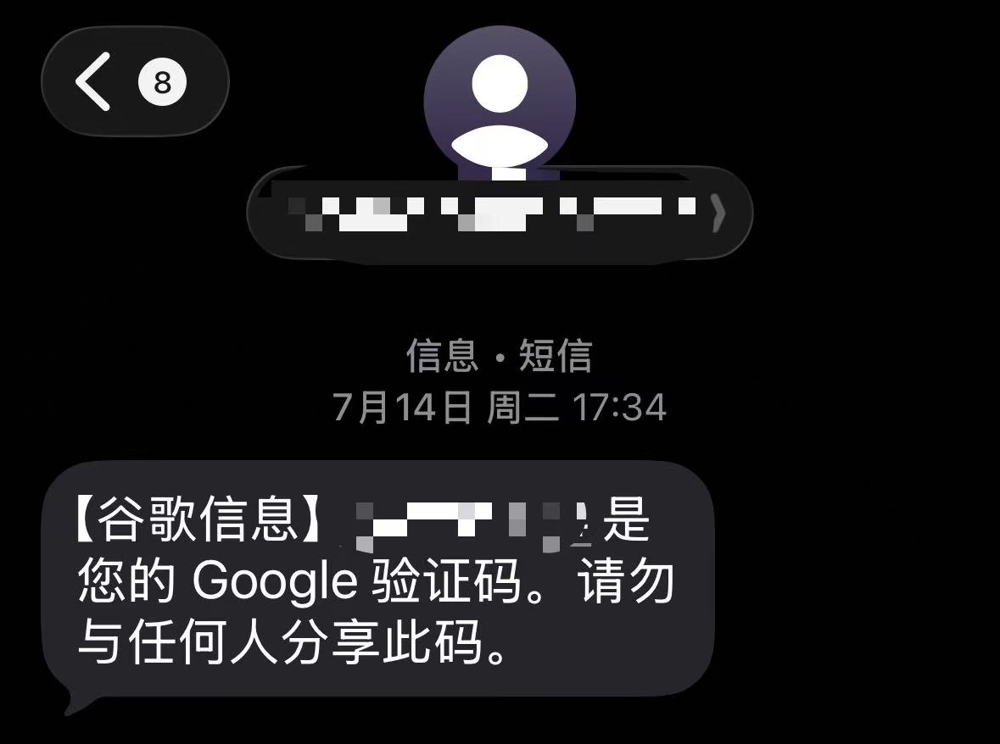
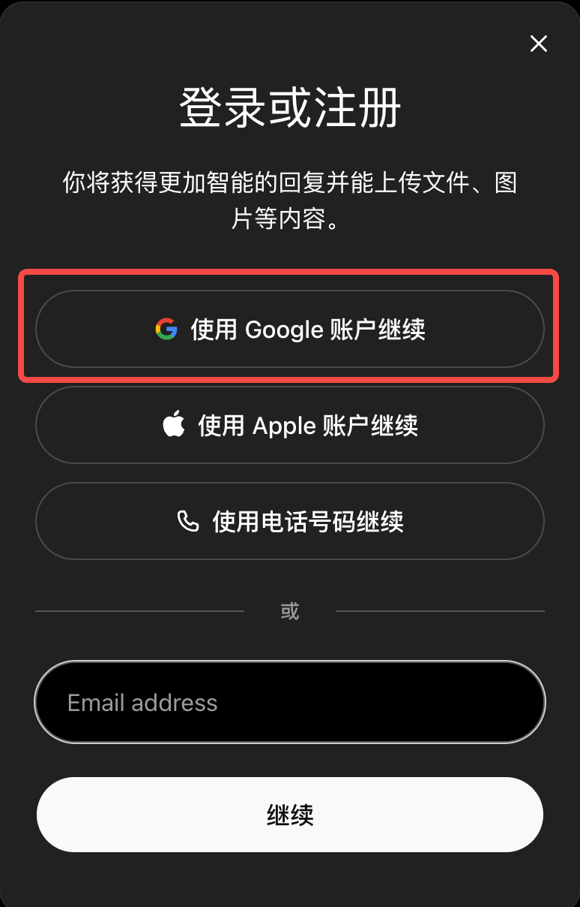
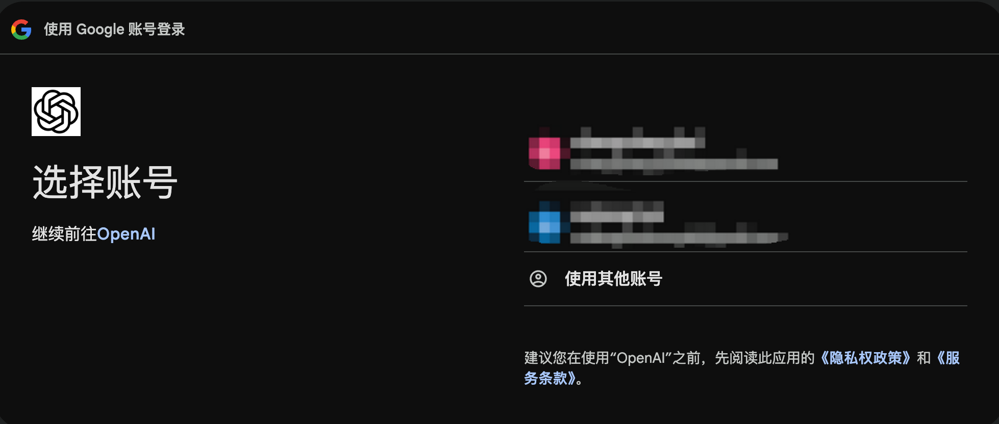

# 怎么注册 ChatGPT 账号？注册 Gmail、登录方式与付款前检查

> 适用：还没有 ChatGPT 账号，或准备付款前想确认账号状态的用户。
> 核心步骤来自 cabbagecabbage 的实测记录（2026-11-09 更新）；最后核对日期 2026-11-15。

## 先说结论

- 注册 ChatGPT 不需要海外手机号：新建 OpenAI 账号和普通 ChatGPT 不要求手机号验证。
- 推荐用 Gmail 注册并长期使用「Continue with Google」登录；以后登录 ChatGPT、Codex 桌面端、CLI 或 IDE 扩展时，都继续使用相同的登录方式和 Gmail，否则可能进入另一个没有订阅和历史记录的账号。
- Codex 桌面端登录可能额外要求手机号验证，见 [Codex 订阅与登录验证](../codex/subscription-and-access.md)。

## 第一步：注册 Gmail（已有海外邮箱可跳过）

本节只适用于还没有可长期使用的海外邮箱的用户。Gmail 主要用于注册 ChatGPT 账号；如果你已经有其他可长期使用的海外邮箱，不必重复注册 Gmail。

准备：一个稳定的海外网络环境，确保可以访问 Google 并完成 Gmail 注册。

1. 打开 [Google 账号注册页面](https://accounts.google.com/signup)。
2. 按页面提示逐步填写信息并完成注册即可。

原作者实测，中国大陆 `+86` 手机号可以完成 Google 页面要求的短信验证。

*图片来源：chatgpt-plus-codex-cn-guide（cabbagecabbage），验证码已由原作者遮挡。*

## 第二步：注册 ChatGPT 账号

1. 打开 [ChatGPT 登录与注册页面](https://chatgpt.com/auth/login)。
2. 选择 **Continue with Google / 使用 Google 继续**。

3. 选择准备使用的 Gmail 账号即可。

*两张截图来源：chatgpt-plus-codex-cn-guide（cabbagecabbage）。*

**以后登录 ChatGPT、Codex 桌面端、CLI 或 IDE 扩展时，都继续使用相同的登录方式和 Gmail**，否则可能进入另一个没有订阅和历史记录的账号。

### 注册需要海外手机号吗？

不需要，新建 OpenAI 账号和普通 ChatGPT 不要求手机号验证（原作者记录）。但 Codex 桌面端登录可能因 IP 触发手机号验证，且手机号一旦绑定无法换绑，刚需 Codex 的用户请先读 [Codex 订阅与登录验证](../codex/subscription-and-access.md)。

## 第三步：付款前必须知道的事

来源 C 在付款前强调三点，详细展开见对应教程：

1. **一个 Apple ID 只能给一个 ChatGPT 账号订阅（永久绑定）。** 第一次付款就要选好准备长期使用的 ChatGPT 账号 → [账号安全与付款前检查](../guides/account-security.md#一个-apple-id-只能给一个-chatgpt-账号订阅永久绑定)。
2. **Codex 二次验证。** 机场 IP / 数据中心 IP 容易触发手机号验证；手机号绑定后无法换绑 → [Codex 订阅与登录验证](../codex/subscription-and-access.md)。
3. **确认你的 Apple 账号是免税区。** 账单地址在免税州（如 Oregon），订阅金额才按标价计算 → [Apple ID 改区](../guides/apple-id-region-change.md#为什么账单州要选-oregon免税州)。

来源 D 的账号确认清单（防止充错账号）：

1. 进入 ChatGPT 的账号设置。
2. 记下当前邮箱或登录方式。
3. 确认这就是你平时保存对话、长期使用的账号。
4. 如果混用过「Google 登录」「Apple 登录」和邮箱登录，最好先退出再重新登录一次。

## 账号安全底线

- Apple ID 和 ChatGPT 账号一定要自己注册，不要购买批量注册的成品账号（来源 W）。
- 不要把账号密码交给任何代充；Session 等登录凭据同样敏感，见 [账号安全](../guides/account-security.md)。

## 相关教程

- [账号安全与付款前检查](../guides/account-security.md)
- [订阅方式总览](./subscription-methods.md)
- [Codex 订阅与登录验证](../codex/subscription-and-access.md)
- [网络环境要求](../guides/network-environment.md)

---

## 来源与修改说明

- 来源仓库：[chatgpt-plus-codex-cn-guide](https://github.com/cabbagecabbage/chatgpt-plus-codex-cn-guide)（cabbagecabbage，CC BY-NC-SA 4.0，已获商业授权，第三、四、五章）；[chatgpt-plus-subscription-guide](https://github.com/daydayup-xq/chatgpt-plus-subscription-guide)（daydayup-xq，CC BY 4.0，付款前账号确认）；[Way-to-ChatGPT-Plus](https://github.com/farion1231/Way-to-ChatGPT-Plus)（farion1231，Apache-2.0，自注册提醒）。
- 修改情况：保留注册步骤与原作者实测结论；「楼主」改为「原作者」；「科学上网」统一为「海外网络环境」；删除求 Star / Issue 导流与中转推广；内部链接改为本站相对链接。
- 图片来源：C 仓库 `docs/images/gmail-google-verification-sms.jpg`、`chatgpt-signup-login-options.png`、`chatgpt-google-account-selection.png` 共 3 张。
- 原教程记录日期：2026-11-09（C）、2026-09-10（D）、2025-06-20（W）；本整合核对日期：2026-11-15。原教程记录于上述日期，当前可用性尚未重新验证。
