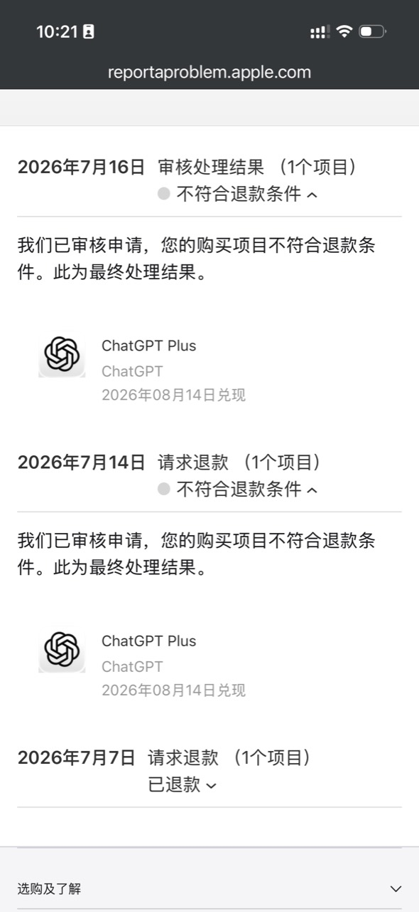
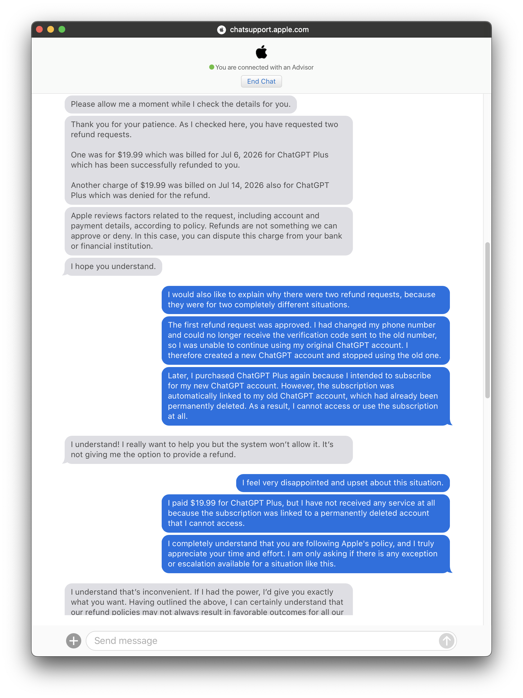
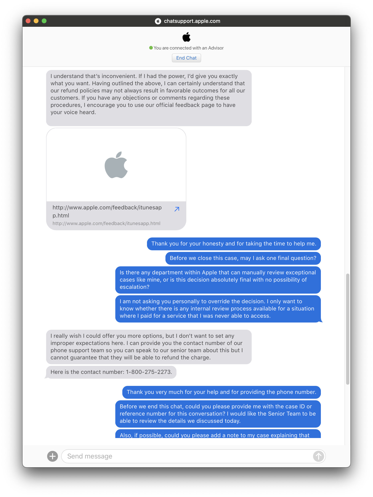

# ChatGPT Plus 怎么续费、取消和退款？官网、Apple、Google 各渠道入口

> 适用：已经订阅 ChatGPT Plus / Pro，想停续费、申请退款或处理重复扣款的用户。
> 最后核对日期 2026-11-15。**想停续费或申请退款，先找出谁收了钱。**

## 先说结论

取消 ChatGPT 自动续费，先从收据确认付款渠道：官网订阅到 ChatGPT 账单管理，Apple、Google 内购到各自商店取消。退款另按对应流程申请：Apple 内购找 Apple，官网和 Google Play 订单按 OpenAI 的相应支持流程处理；第三方代充回原订单或联系商家客服。

**取消续费不等于退款，卸载 App 也不会取消商店订阅。**

## 各渠道入口一览

| 你在哪里付款 | 查订阅或停止下次扣费 | 退款找谁 |
| --- | --- | --- |
| ChatGPT 网页结算 | 登录原账号 → 头像 → Settings → Billing → Cancel plan → Cancel | 按 OpenAI 的支持流程申请 |
| Apple App Store | iPhone 设置 → 你的姓名 → 订阅 → ChatGPT → 取消订阅 | 向 Apple 申请（reportaproblem.apple.com） |
| Google Play | Play 商店 → 头像 → 付款和订阅 → 订阅 → ChatGPT → 取消 | 按 OpenAI 对 Google Play 订单的支持流程申请 |
| 第三方代充 | 按商品条款：多为一次一个月，到期后需重新下单 | 未开通且订单有「申请退款」按钮时点该按钮；否则带订单号找客服 |

## 不知道谁扣的费，按这个顺序找

1. **查找付款收据。** 搜索邮件中的付款收据，辨认商家：OpenAI、Apple、Google 还是第三方。核对金额、日期和订单号，不要只看银行短信。
2. **确认官网账单。** 收据是 OpenAI，登录同一个 ChatGPT 账号打开「设置 → 账单」；是 Apple，打开 iPhone「设置 → 你的姓名 → 订阅」；是 Google，打开 Play 商店「付款和订阅 → 订阅」。
3. **确认第三方订单。** 打开下单邮箱里的订单链接，看当前订单状态和商品售后；找不到订单按 [付款后没到账排查](./subscription-not-active.md#第三方代充订单) 的找回步骤操作。

## 怎么停下次自动扣费

按上表走到具体订阅后，点击取消并完成最后的确认页面。OpenAI 说明**最好在下次扣费日前至少 24 小时取消**；取消后通常可用到已付款周期结束。只有看到取消确认或到期日期，才算操作完成（[OpenAI 取消订阅说明](https://help.openai.com/en/articles/7232927-canceling-your-chatgpt-subscription)）。

- Apple 内购即使删除 ChatGPT 账号，也应先到 Apple 订阅列表核对；Google 内购也同理。
- Apple 订阅页没有取消按钮、但已显示到期日期，通常说明自动续费已经关闭（来源 D）。
- 取消后会员会立刻消失吗？通常只是关闭下一周期续费，已支付的周期仍可继续使用，具体到期时间以取消页面显示为准（来源 D）。

## Apple 内购怎么退款

来源 C 整理的步骤（2026-11-09 记录）：

1. 打开 [Apple 退款页面](https://reportaproblem.apple.com/)，登录付款时使用的美区 Apple ID。
2. 在「我需要」中选择「请求退款」，按实际情况选择原因，点击「下一步」。
3. 选中要退款的 ChatGPT 订阅订单，点击「提交」。
4. 提交后可在同一页面查看申请状态；Apple 通常会在 24～48 小时内更新处理结果，退款获批后还需等待款项到账。步骤可参考 [Apple 退款说明](https://support.apple.com/zh-cn/118223)。

### 原作者的退款经历：机会可能只有一次

来源 C 作者（cabbagecabbage）的实测记录：

- 7 月 5 日下午：通过 iOS 开通 Plus。
- 7 月 7 日：Codex 登录触发二次验证，申请退款，**首次申请获批**，$20 退回 Apple 余额。
- 随后使用同一 Apple 账号在新 ChatGPT 账号里再次购买，但订阅仍关联到已经注销的旧账号（Apple ID 绑定规则）。
- 7 月 14 日：第二次申请退款，被判定为不符合退款条件。
- 7 月 16 日：复核后仍被拒绝，页面显示为最终结果。
- 7 月 17 日：Apple 在线客服表示普通顾问无法继续操作，只能尝试拨打美区支持电话 `1-800-275-2273` 联系高级团队，且不能保证退款；邮件也不能替代这一步。

*Apple 退款处理记录：7 月 7 日首次退款获批，7 月 14 日、16 日的后续申请被拒。图片来源：chatgpt-plus-codex-cn-guide（cabbagecabbage）。*

*原作者与 Apple 客服沟通退款问题的实际记录。图片来源：chatgpt-plus-codex-cn-guide（cabbagecabbage）。*

**原作者的结论：不要指望退款反复兜底，第一次付款就要选对账号。** 这是个人经历，不代表 Apple 的通用政策；退款结果由 Apple 按个案判定。

## 发现两处扣款时

先分别查 ChatGPT 网页、Apple 和 Google 的订阅列表，找出是否同时存在两份订阅。决定保留哪一份，然后在另一份实际扣费的平台取消。**不要因为一个平台显示 Free 就断定另一个平台的订阅已停止**；收据和平台订阅列表是关键证据（来源 L，[OpenAI 避免重复扣款说明](https://help.openai.com/en/articles/20001043-how-do-i-avoid-being-charged-twice-if-i-subscribe-to-chatgpt-on-ios-android-and-the-web)）。

## 第三方代充的续费与退款

- 多数第三方 Plus 商品是一单一个月，不绑定自动扣费；到期后需重新下单，会员时长一般不叠加，建议临近到期再操作。
- 已有 Plus 未到期时，部分商品不能覆盖或提前续费；iOS 内购刚到期时，还要确认 Apple 的实际宽限期已结束，不能只看账号显示 Free。
- 未开通且订单页有「申请退款」按钮时在原订单申请；申请后通常不能撤回，款项原路退回。没有按钮带订单号找客服。开通后的问题按购买时的售后条款处理。
- 以上为来源 L、A 记录的商品规则示例，**具体以你购买时的商品页和条款为准**，不同平台规则不能互相套用。

## 相关教程

- [付款后没到账怎么办](./subscription-not-active.md)
- [账号安全与付款前检查](../guides/account-security.md)
- [iOS 订阅完整流程](./subscribe-ios.md)
- [第三方订阅风险](./third-party-subscription.md)

---

## 来源与修改说明

- 来源仓库：[GPTplusSub](https://github.com/laoma528/GPTplusSub)（laoma528，无许可证，经项目负责人确认授权，`billing.html`）；[chatgpt-plus-codex-cn-guide](https://github.com/cabbagecabbage/chatgpt-plus-codex-cn-guide)（cabbagecabbage，CC BY-NC-SA 4.0，已获商业授权，第八章退款步骤与经历）；[chatgpt-plus-subscription-guide](https://github.com/daydayup-xq/chatgpt-plus-subscription-guide)（daydayup-xq，CC BY 4.0，取消 FAQ）；[chatgpt-plus-china-guide](https://github.com/Avarce/chatgpt-plus-china-guide)（Avarce，无许可证，经项目负责人确认授权，第三方续费规则示例）。
- 修改情况：合并渠道表与退款流程；ProdClub 专属规则泛化为「第三方商品示例」并删除导流链接与优惠码；保留原作者退款经历的全部日期与截图；「楼主」改为「原作者」。
- 图片来源：C 仓库 `docs/images/apple-refund-record-2026-07.jpg`、`apple-support-refund-chat-1/2.png` 共 3 张（原作者提供的客服记录，无有效凭据）。
- 原教程记录日期：2026-11-14（L）、2026-11-09（C）、2026-09-10（D）、2026-11-12（A）；本整合核对日期：2026-11-15。原教程记录于上述日期，当前可用性尚未重新验证。
