# 华为手机没有 Google Play，怎么用国内银联卡订阅 ChatGPT Plus？

> 适用：有稳定新加坡节点、愿意折腾 Google Play 的华为 / 荣耀等无 GMS 机型用户。
> 原教程为 CZGPT 2026 年 8 月在 Huawei Mate 70 Pro+（HarmonyOS 4.3.0）上的实测，13 张截图全流程；最后核对日期 2026-11-15。当前可用性尚未重新验证。

> **阅读前请注意：** 本文是原作者在特定设备、系统、地区与银行卡条件下的历史实测记录，不代表所有华为 / 安卓设备或所有银联卡都适用。Google Play 账号地区由账号的付款资料决定，**不是只由节点 IP 决定**；银联卡能否绑定和付款，以你账号所在地区付款页面的实际显示为准。

## 原理与结论

通过 **Google Play（新加坡区）绑定国内银联储蓄卡**完成订阅付款——不需要 Visa/Mastercard，不需要虚拟卡，不需要海外礼品卡。原作者全程亲测成功。

适合人群：有稳定新加坡节点、愿意折腾 Google Play 的用户。不想折腾的读者先看 [订阅方式总览](./subscription-methods.md)。

## 准备条件

首先确认两个准备条件：

1. **有新加坡的节点，操作过程中全程开启不要中断（很重要！）**
2. **Google Play 和 ChatGPT 的账号一致，都用同一个 Google 账户登录。**

用到的 App：Google Play、出境易、ChatGPT。

原作者的手机型号：Huawei Mate 70 Pro+，系统 HarmonyOS 4.3.0。其他机型界面可能略有差异。

## 具体步骤

### 1. 登录 Google Play

新加坡节点全程开启，手机浏览器搜索 Google Play → 点击进入官网 → 点击官网右上角灰色的头像 → 点击【使用 Google 账号登录】。

**注意：登录一定要和 ChatGPT 一样的 Google 账号。**

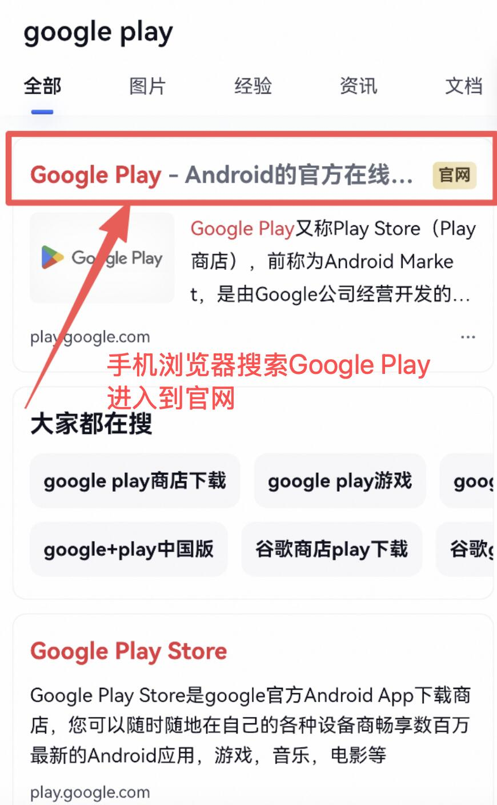

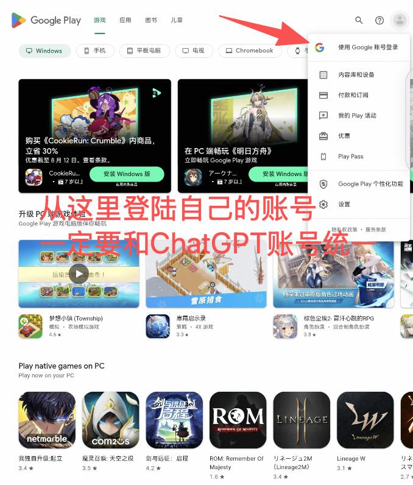

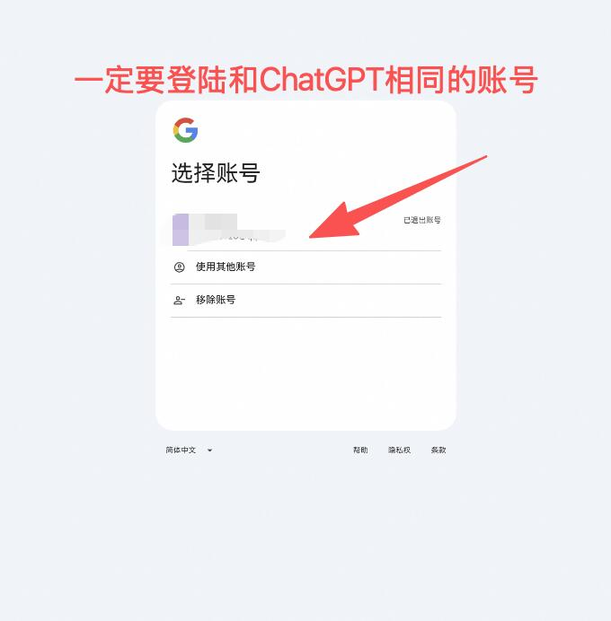

### 2. 确认地区

同样是在官网首页 → 点击已登录的右上角头像 → 点击设置 → 确认【国家/地区和个人资料】模块的地区是否显示为**新加坡**。

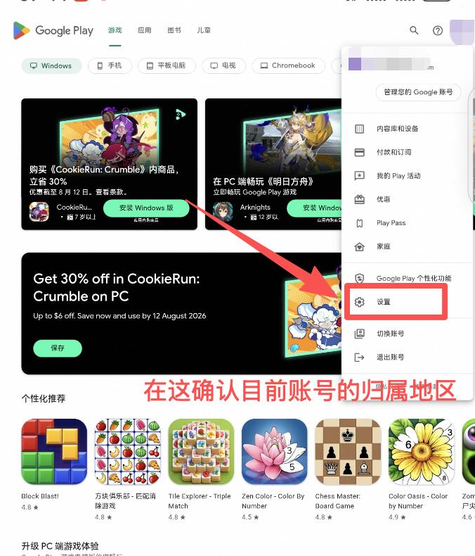

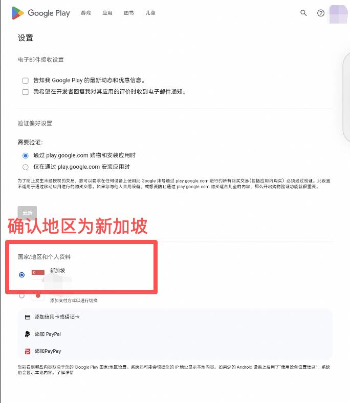

### 3. 添加国内银联银行卡

一个入口是在步骤二的地区下面，有一个【添加信用卡或借记卡】的地方，直接填写卡号和绑定的手机号，点击继续，会有一个验证码需要验证，填写手机收到的验证码即可，就可以绑定自己的国内储蓄卡了。

（还有另一个入口是在 Google Play 首页头像点击后出现的【付款和订阅】入口，点进去在【支付方式】下面点击【添加信用卡或借记卡】，后面步骤同上。）

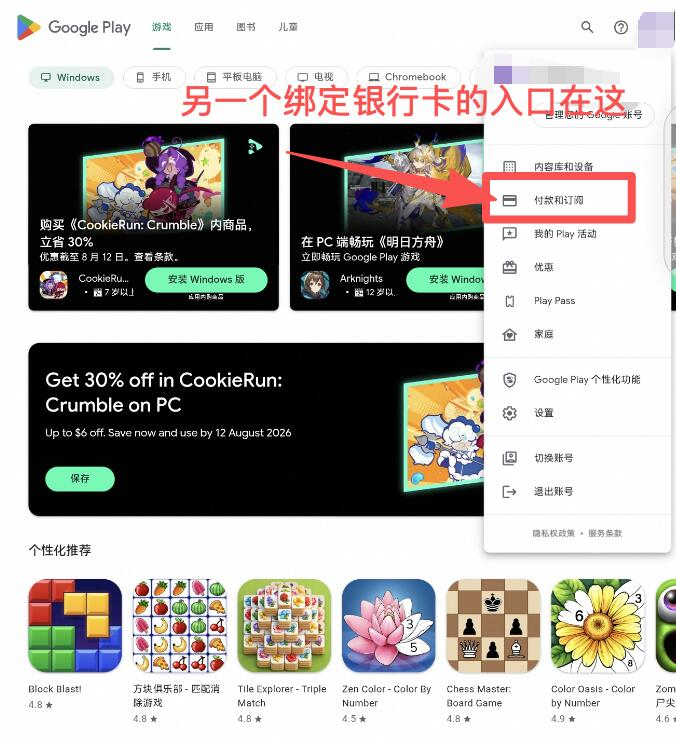

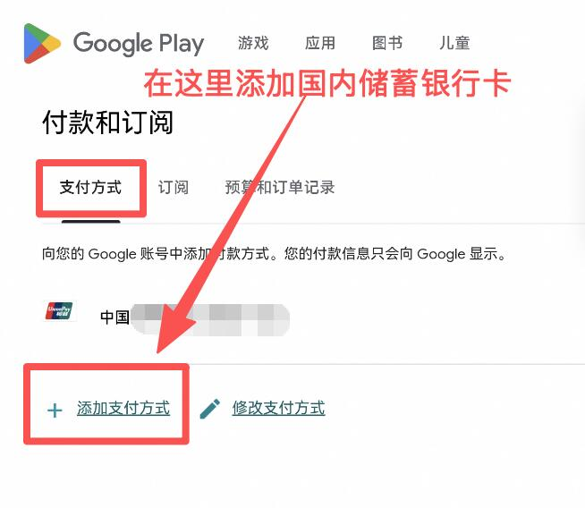

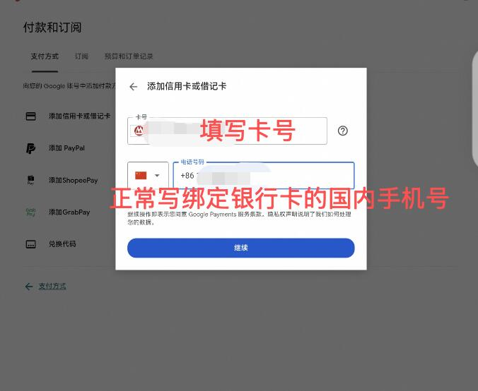

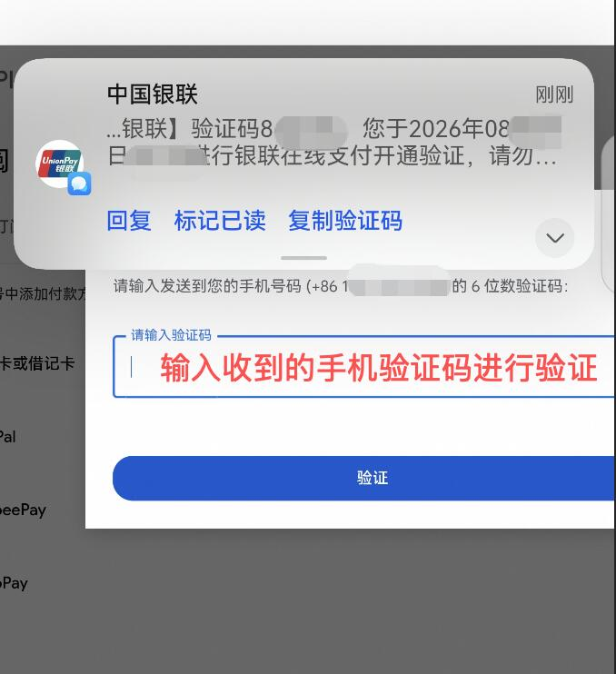

### 4. 下载 ChatGPT（华为用户）

华为用户这时候请回到【出境易】App，如果没有的需要在应用市场下载；出境易里面搜索找到 ChatGPT 应用，下载（**一定要连节点，没有节点的话无法下载境外应用**）。

### 5. 订阅付款

打开 ChatGPT，登录和 Google Play 一样的 Google 账号，在左侧对话栏找到右下角头像，点击进入，找到订阅 Plus 选项，点击，会跳转一个支付窗口，点击订阅并直接付款就可以。

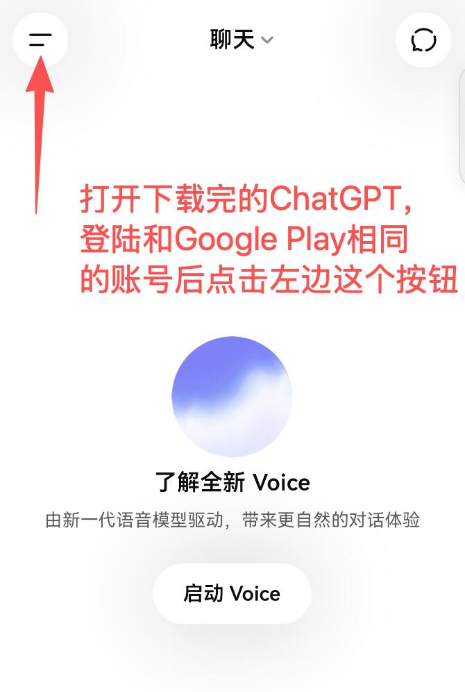

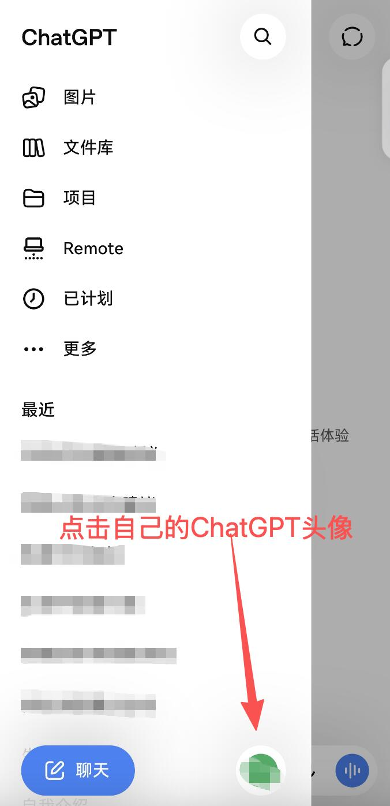

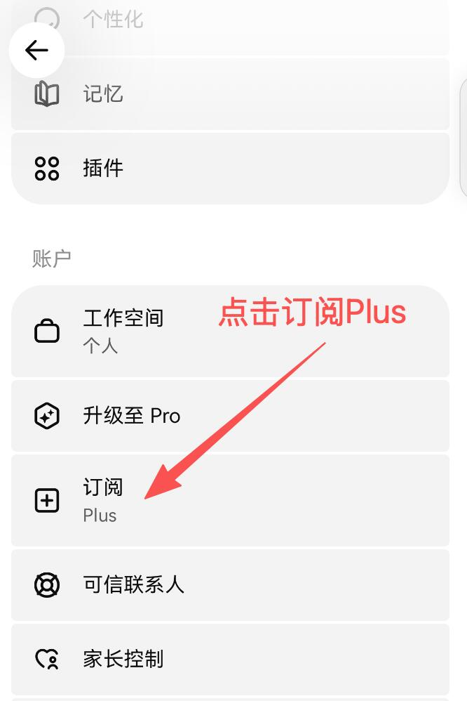

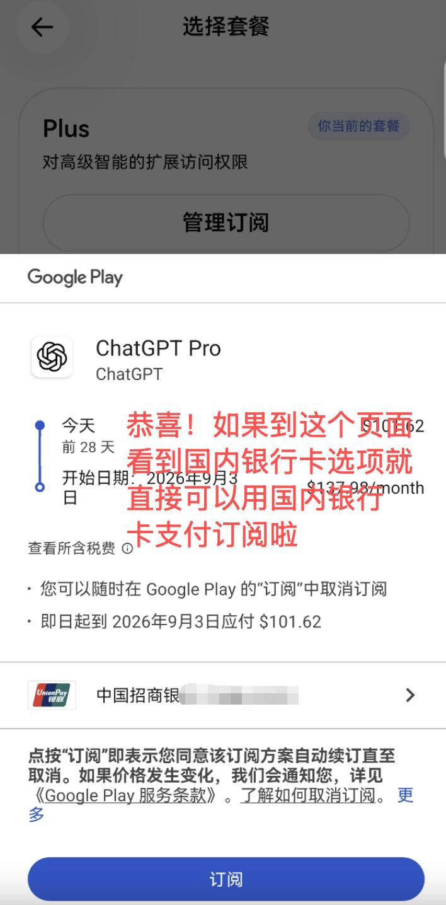

如果到支付页面看到国内银行卡选项，就直接可以用国内银行卡支付订阅。

*以上 13 张截图来源：chatgpt-yinlian-chongzhi（CZGPT），2026-08 实测。卡号、手机号、验证码等敏感信息已由原作者遮挡。*

## 常见问题 FAQ（原作者整理）

**Q：为什么必须全程开新加坡节点？**
A：因为 Google Play 的支付方式和商店内容跟着「当前访问地区 + 账号地区」走。节点中断或跳到其他地区，绑卡和付款步骤都可能失败，所以从登录到付款完成前不要断开。

**Q：银联卡绑定失败 / 验证码收不到怎么办？**
A：先确认是储蓄卡且开通了短信验证；部分银行对境外商户扣款默认关闭，需要在银行 App 里开启「境外支付」。换一张卡（建议大行借记卡）成功率更高。

**Q：扣款是人民币还是外币？会有汇率损失吗？**
A：Google Play 新加坡区按新币（SGD）计价，银联通道会自动换汇成人民币扣款，汇率按扣款当日银联牌价，会有小幅汇率差。

**Q：订阅会自动续费吗？怎么取消？**
A：会。Google Play 订阅默认每月自动扣款，取消入口在 Google Play →【付款和订阅】→【订阅】里，随时可以取消，取消后当期仍可用到期。

**Q：Play 账号地区不是新加坡怎么办？**
A：按 Google 官方说明，Play 国家/地区**首次设置后至少 90 天才能更改，之后每次更改也需至少间隔 90 天**，且要求实际位于新地区、使用当地可用的付款方式（[官方说明](https://support.google.com/googleplay/answer/7431675?hl=zh-Hans)，2026-11-16 核对）。如果你的账号地区不在新加坡也不想折腾改区，这条路线不适合你，可以看 [iOS 礼品卡路线](./subscribe-ios.md) 或 [订阅方式总览](./subscription-methods.md)。

## 局限与提醒

- 这条路线需要稳定的新加坡节点、Play 账号地区恰好在新加坡，且 Google Play 订阅按美元/新币计价、自动续订。条件不满足时不要硬试。银联卡是否被接受，以新加坡区付款页面实际显示的可用付款方式为准，不是所有银联卡都支持。
- 原教程记录于 2026-08，当前可用性尚未重新验证；Google Play 的地区与绑卡政策可能变化，以页面实际提示为准。
- 付款前确认 ChatGPT 登录的是你长期使用的账号，见 [账号安全与付款前检查](../guides/account-security.md)。

## 相关教程

- [Android / Google Play 订阅（通用）](./subscribe-android.md)
- [订阅方式总览](./subscription-methods.md)
- [续费、取消与退款](./renewal-and-refund.md)
- [网络环境要求](../guides/network-environment.md)

---

## 来源与修改说明

- 来源仓库：[chatgpt-yinlian-chongzhi](https://github.com/CZGPT/chatgpt-yinlian-chongzhi)（CZGPT，无许可证，经项目负责人确认授权）。
- 原始文档：README 全文（2026-08 华为手机实测）。
- 修改情况：保留全部步骤、截图与 FAQ；**删除文末 czgptai.com 自助充值平台推广、「省事方案」导流段与关联仓库引流链接**；补充局限说明与日期标注；「亲测」表述保留为原作者实测，不改为本站实测。2026-11-16 按 Google 官方说明更正改区间隔表述（原「一年只能改一次」改为官方 90 天规则），并在文首补充历史实测适用范围提示。
- 图片来源：Y 仓库 `assets/` 13 张实测截图，敏感信息原作者已遮挡。
- 原教程记录日期：2026-08（最后提交 2026-11-14）；本整合核对日期：2026-11-15。当前可用性尚未重新验证。