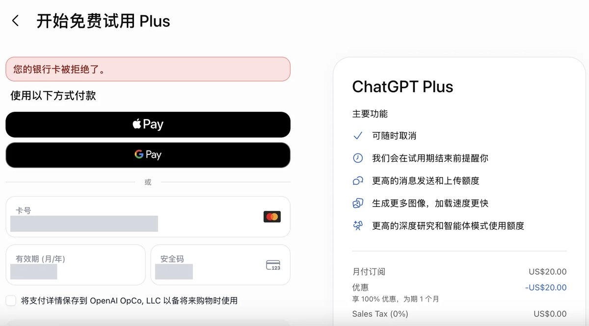

# ChatGPT Plus 怎么订阅？国内常见方式一次讲清

> 适用：准备给 ChatGPT 订阅 Plus / Pro，但不知道选哪条路线的用户。
> 最后核对日期 2026-11-15。价格、界面和支付规则可能变化，付款时以你自己页面显示的内容为准。

## 懒人版：我应该选哪一种？

| 你的情况 | 优先考虑 | 难度 | 教程 |
| --- | --- | --- | --- |
| 有网页结算页支持的海外银行卡 | ChatGPT 网页直接订阅 | 简单 | [官网订阅](./subscribe-official.md) |
| 使用 iPhone / iPad | Apple 礼品卡 + App Store 内购 | 较简单 | [iOS 订阅](./subscribe-ios.md) |
| 使用 Android，手机有 Google Play | Google Play 内购 | 中等 | [Android 订阅](./subscribe-android.md) |
| 华为手机，没有 Google Play | Google Play 新加坡区 + 国内银联卡 | 中等偏折腾 | [华为手机订阅](./subscribe-huawei.md) |
| 想在网页订阅，也愿意研究海外支付 | VCC 虚拟卡 | 较复杂 | [虚拟卡](../guides/virtual-card.md) |
| 不想研究支付、换区和礼品卡 | 第三方代充（先读风险） | 低（由商家操作） | [第三方订阅](./third-party-subscription.md) |

一句话建议（来源 D）：**能直接付款就走网页；苹果用户优先 App Store；安卓用户优先 Google Play。**

Apple 和 Google Play 都不一定要使用主账户。如果主账户已经有其他订阅或地区资料，可以新建一个专门负责 ChatGPT 购买的账户，具体步骤在对应教程。

## 为什么国内充 Plus 这么难

在 ChatGPT 网页结账页付款被拒，多数不是操作错了。按 OpenAI 帮助中心的说法，一张卡能不能付，先看三件事：发卡银行在哪里、你本人在哪里、账单信息和银行登记的是否一致（来源 A）：

- **发卡银行要在 OpenAI 支持的国家和地区。** 2026-10-27 查看[支持的国家和地区](https://help.openai.com/en/articles/7947663-chatgpt-supported-countries)，中国大陆、香港、澳门都不在名单里。看的是发卡银行，不是卡面上的 Visa、Mastercard 标志：国内银行发的双币卡、全币卡，发卡银行仍在中国大陆。
- **海外银行发的卡，也可能被拒。** OpenAI 要求你本人和发卡银行都在支持地区，任何一方不在，付款都可能被拒（[续费付款排查](https://help.openai.com/en/articles/7242622-troubleshooting-chatgpt-plus-or-pro-renewal-payments)）。
- **结账页不说原因。** 付款没通过时只显示「付款未获批」或「您的银行卡被拒绝了」。银行通常不会把拒绝的具体原因告诉 OpenAI，要问原因只能找发卡银行。
- **$0 的免费试用也要验卡。** 部分免费试用要先绑一张有效的付款方式（[免费试用 FAQ](https://help.openai.com/en/articles/8381046-chatgpt-promotional-subscriptionsfree-trial-invites-faq)）。

*图片来源：chatgpt-plus-china-guide（Avarce），2026-10-27 实拍：领取一个月免费试用 Plus，当天应付 $0，结账页仍提示「您的银行卡被拒绝了」。*

**结论：** 国内银行发的卡不在官方支持范围内，别反复试。想开 Plus，可以选择海外卡官方直付、美区 Apple ID + 礼品卡、Google Play、虚拟卡，或第三方充值。

## 几条路线的成本与风险对比

下表按客观维度对比（操作难度指自助操作的复杂度；礼品卡价格为原作者历史实测记录，当前以页面为准）：

| 订阅方式 | 适用条件 | 操作难度 | 费用构成 | 交付 / 到账方式 | 主要风险与限制 | 教程 |
| --- | --- | --- | --- | --- | --- | --- |
| 官网直付 | 有 OpenAI 支持地区的银行卡，本人位于支持地区 | 低 | $20/月 + 税费（以结算页为准） | 付款成功即时生效，官方自动续费 | 国内卡（含双币卡）常被拒；地区规则不可绕过 | [官网订阅](./subscribe-official.md) |
| 美区礼品卡内购 | iPhone / iPad + 美区 Apple ID | 中：注册 / 改区 + 买卡 + 兑换 | 礼品卡购买成本 + 汇率差（原作者 2026-10 复测 $20 卡 ¥134.44；SEAGM 11-06 实付 ¥138.13，均为历史记录） | 兑换码充入 Apple 余额后内购，即时生效 | 仅限 iOS；礼品卡来源风险；Apple 账号与 ChatGPT 账号可能形成关联 | [iOS 订阅](./subscribe-ios.md) |
| Google Play（含华为银联） | 对应地区 Play 账号；银联路线另需新加坡节点等特定条件 | 中 | 按 Play 地区计价 + 汇率（银联通道自动换汇） | 内购付款成功即时生效，自动续费 | 地区与改区限制（首次设置后至少 90 天才能更改）；并非所有设备或银联卡适用 | [Android](./subscribe-android.md) · [华为](./subscribe-huawei.md) |
| 虚拟国际卡 | 发卡平台 KYC、干净网络；2026 年主流平台已停运 | 高 | 开卡费 + 月费 + 充值费 + 汇损 | 充值到卡后由官网扣款 | 平台停运 / 跑路、风控拒付；失效平台见[历史归档](../guides/payment-history-archive.md) | [虚拟卡](../guides/virtual-card.md) |
| 第三方代充 | 接受非官方路径；账号与商品条件以商家说明为准 | 低：人民币付款，由商家操作 | 以订单页为准（随平台 / 汇率变化） | 交付方式与预计处理时间以购买时的商品说明及订单状态为准 | 依赖商家售后；凭据安全；地区规则不变 | [第三方风险](./third-party-subscription.md) |
| 共享号 / 成品号 | 无（不推荐） | 低 | 低于正常订阅价 | 商家交付账号使用权或整个账号 | 聊天记录暴露、随时封号或被收回 | [第三方风险](./third-party-subscription.md) |

各路线的详细教程：

- **官方直付：** [官网订阅步骤](./subscribe-official.md) · [海外卡逐项填写](../guides/international-card.md)
- **Apple 礼品卡：** [Pockyt 支付宝买卡](../guides/apple-gift-card-pockyt.md) · [SEAGM 备用](../guides/apple-gift-card-seagm.md) · [Apple 官网银联买卡](../guides/apple-gift-card-official.md) · [iOS 订阅](./subscribe-ios.md)
- **Google Play：** [Android 订阅](./subscribe-android.md) · [华为手机银联路线](./subscribe-huawei.md)
- **虚拟卡：** [条件、费用与操作](../guides/virtual-card.md)（2026 年主流平台已停运，先读现状）
- **第三方代充：** [代充、成品号、共享号的区别与风险](./third-party-subscription.md)

## 关于第三方充值服务

「微信 / 支付宝直充 ChatGPT」本质上都是第三方在中间转了一道：OpenAI 官方收的是国际信用卡、Apple / Google 的应用内购买，以及在美国销售的 OpenAI 礼品卡，官网没有面向中国大陆的支付宝、微信直付入口（来源 A、L）。

第三方服务主要看四件事（来源 D）：

1. 到底订阅的是 Plus 还是 Pro；
2. 订阅会落到哪个 ChatGPT 账号；
3. 后续由谁续费和取消；
4. 失败、掉订阅或退款怎么处理。

价格明显低于正常成本、承诺「永久会员」或完全说不清付款来源的，不建议选。更完整的挑选指标（5 条硬指标）和凭据安全红线见 [第三方订阅风险专篇](./third-party-subscription.md)。

> 「AI 订阅研习社」也提供充值到本人账号的独立第三方服务说明，见 [仓库首页「服务与声明」](../README.md#服务与声明)。我们与 OpenAI、Apple、Google 均无隶属或授权关系。

## 开始前，先确认这个账号

很多人订阅失败，不是钱没付出去，而是会员充到了另一个账号。付款前先确认当前登录邮箱和登录方式，详见 [账号安全与付款前检查](../guides/account-security.md)。

## 相关教程

- [没有海外银行卡怎么订阅](./no-foreign-card.md)
- [Plus 和 Pro 怎么选](./plus-vs-pro.md)
- [付款失败排查](./payment-failed.md)
- [常见问题合集](./faq.md)

---

## 来源与修改说明

- 来源仓库：[chatgpt-plus-subscription-guide](https://github.com/daydayup-xq/chatgpt-plus-subscription-guide)（daydayup-xq，CC BY 4.0，方式对比表与四件事）；[chatgpt-plus-china-guide](https://github.com/Avarce/chatgpt-plus-china-guide)（Avarce，无许可证，经项目负责人确认授权，为什么难、成本对比表）；[GPTplusSub](https://github.com/laoma528/GPTplusSub)（laoma528，无许可证，经项目负责人确认授权，路线总览与地区结论）。
- 修改情况：合并三个来源的方式对比；**删除 D 来源「直接找我订阅」的抖音导流章节与 A 来源 AONIR 服务推广**，第三方服务改为通用挑选标准；按任务要求在本篇保留第三方说明入口；内部链接改为本站相对链接。2026-11-16 将成本对比表重建为客观维度（适用条件 / 操作难度 / 费用构成 / 交付方式 / 风险限制），删除原表中无依据的「隐私 / 稳定性 / 综合」评级与「靠谱平台几分钟到账」「多数非技术用户最现实」等表述；历史实测价格保留并标注为历史记录。
- 图片来源：A 仓库 `images/checkout-card-declined-20261027.jpg`（原作者实拍，无个人敏感信息）。
- 原教程记录日期：2026-09-10（D）、2026-11-12（A）、2026-11-14（L）；本整合核对日期：2026-11-15。原教程记录于上述日期，当前可用性尚未重新验证。
