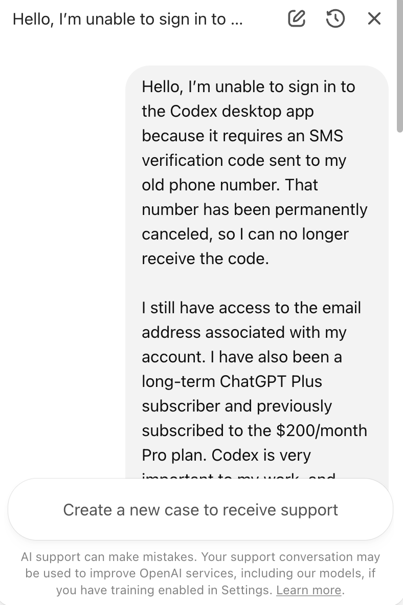
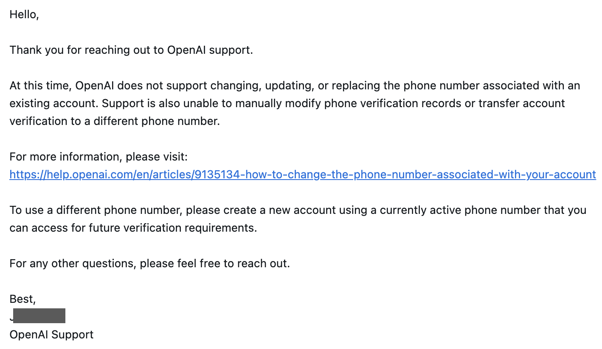

# Codex 怎么开通和登录？二次验证、接码与申诉实录

> 适用：已订阅或准备订阅 ChatGPT Plus / Pro，需要在桌面端使用 Codex 的读者。
> 最后核对日期：2026-11-15。验证机制与接码平台政策可能变化，以实际页面提示为准。

## 先说结论

- Codex 不需要单独订阅：ChatGPT Plus / Pro 订阅即包含 Codex 使用额度。订阅流程见 [ChatGPT iOS 订阅](../chatgpt/subscribe-ios.md) 或 [官网自助订阅](../chatgpt/subscribe-official.md)。
- **Codex 桌面端登录可能触发手机号验证，且手机号一旦绑定永远无法解绑或换绑。** 这是国内用户用 Codex 最大的坑，ChatGPT 网页版和手机端不受影响。
- 用临时接码号码完成首次验证后，**尽量保持登录状态，不要退出登录**；需要切换账号用 CC Switch。
- 触发二次验证又收不到原号码验证码时，目前没有任何跳过方式，只能申诉、换纯净 IP、等风控放宽或注销重注册。

## 先确定需求：ChatGPT Work 还是 Codex

原作者给出的入门判断（深度用户按实际需求自行判断）：

| 需求 | 优先选择 |
| --- | --- |
| 对话、调研、文档、表格、网页任务 | ChatGPT Work |
| 让 AI 参与代码开发：修改项目文件、运行测试、处理 Git | Codex |
| 新手不知道怎么判断 | 非程序员优先 Work，程序员优先 Codex |

两者的注册、订阅流程基本一致，但 **Codex 最好额外准备一个能长期接收短信验证码的海外手机号**；没有的话看下面的替代方案与风险。

## 二次验证机制：付款前就要知道

**触发原因**：使用机场 IP 或数据中心 IP（而非纯净家宽）登录时，很可能被要求手机号验证。

- **首次验证**：输入手机号 → 收到短信 → 填入验证码，完成手机号绑定和首次验证。
- **二次验证**：以后重新登录时，如果登录 IP 不干净，仍可能要求验证。OpenAI 会向**之前绑定的手机号**发送验证码，填入后才能登录。

**手机号一旦绑定，永远无法解绑或换绑。** 一旦触发二次验证而收不到原手机号的验证码，就无法登录桌面端 Codex。ChatGPT 网页版和手机端不受影响。

按自己的条件对号入座（原作者判断）：

1. **有 100% 纯净且长期稳定的家宽 IP**：不会被要求手机号验证，一次都不会。但原作者估计 95% 以上的人无法保证这一点。
2. **没有纯净 IP，但有能稳定接收验证码的国外手机号**：也可以，后续验证继续用这个号码收短信。**中国手机号不行。**
3. **两者都没有**：只能用接码网站收一次临时验证码，同时承担以后触发二次验证就无法登录的风险。

## Codex 登录流程

1. 在桌面端 Codex 中选择使用 ChatGPT 账号登录。
2. Codex 跳转到网页端登录页面，选择 **Continue with Google / 使用 Google 继续**。
3. 选择注册 ChatGPT 时使用的 Gmail 账号（注册见 [注册 ChatGPT 与付款前检查](../chatgpt/account-and-precheck.md)）。
4. 首次登录时，按页面提示绑定手机号并完成短信验证。

### 临时接码方案（风险自担）

如果能接受「以后可能触发二次验证、临时号码无法找回」的风险，可以用临时接码网站完成首次验证。原作者使用的是 [Hero SMS](https://hero-sms.com/cn)（记录于 2026-07，当前可用性尚未重新验证）：

- 首次需充值约 2 美元，每次接码成本约 0.5 元人民币。
- 选一个热门地区的号码即可。
- **临时号码有效时间只有 20 分钟，后续无法找回。原作者的原话：「二验就寄」。**

接码平台属于第三方服务，号码可用性、价格与政策随时可能变化；本文不构成对任何接码平台的推荐。

### 用临时号码验证后：保持登录，用 CC Switch 切换

- **尽量保持登录状态，不要退出登录。** 退出后重新登录可能触发二次验证。
- 需要频繁切换账号时，使用 [CC Switch](https://github.com/farion1231/cc-switch) 切换登录状态，避免反复退出和重新登录。
- **坑点（原作者提醒）**：建议每天通过 CC Switch 切换并登录一次 Codex。长时间不登录，保存的登录状态可能失效，之后仍需重新登录，就可能触发二次验证。

## 触发二次验证收不到验证码，怎么办

目前二次验证没有任何跳过方式。只能从以下选项里选：

1. 向 OpenAI 申诉（见下方实录，不保证成功）。
2. 寄希望于风控策略放宽。
3. 换纯净 IP 再试。
4. 注销账号，等待邮箱一个月后解除占用，再重新注册并绑定新的手机号。

### 申诉方法

1. 通过 [OpenAI Help Center](https://help.openai.com/) 右下角聊天入口联系支持。
2. 与英文客服沟通时，可以用 ChatGPT 翻译对方回复并生成英文答复。

### 原作者的申诉实录（2026 年 7 月）

**7 月 14 日**：原作者就「触发二次验证、无法接收验证码登录桌面端 Codex」向 OpenAI 客服提交申诉。

**7 月 18 日**：OpenAI 客服回复——目前不支持更改、更新或替换账号关联的手机号，客服也无法手动修改手机号验证记录；如需使用其他手机号，只能创建新账号。

**同日**：原作者再次尝试登录 Codex，发现不需要二次验证了，可以正常进入。无法确认是申诉生效、账号风控解除，还是整体验证策略有所放宽。

**截至 7 月 27 日**：原作者共有 3 个通过上述途径注册并开通 Plus 的账号，都在稳定使用；7 月 18 日之后暂未再次出现登录失效或触发二次验证。以上只是原作者当时的实际使用情况，**不代表后续一定不会再次触发验证**。

## FAQ

**Q：只用 ChatGPT 网页版 / 手机端，需要管这些吗？**
A：不需要。手机号二次验证只影响桌面端 Codex 登录，网页版和手机端不受影响。

**Q：中国手机号能绑定 Codex 吗？**
A：原作者实测结论是不行（记录于 2026-07）。需要能稳定接收验证码的国外手机号，或承担临时接码的风险。

**Q：申诉一定能解除二次验证吗？**
A：不一定。原作者的申诉被客服明确拒绝（无法换绑手机号），但同日登录又恢复了，原因不明。申诉只能作为尝试，不能当作兜底方案。

**Q：绑定的号码不用了怎么办？**
A：按目前政策无法换绑。这就是为什么首次验证就要选能长期使用的号码，或干脆保持登录状态不退出。

## 相关教程

- [Codex 模型与推理强度选择](./model-selection.md)
- [Codex 周额度与中转性价比](./usage-and-limits.md)
- [Codex 降智自测与恢复](./troubleshooting.md)
- [Windows 版 Codex 安装](./windows-install.md)
- [ChatGPT iOS 订阅](../chatgpt/subscribe-ios.md) · [注册与付款前检查](../chatgpt/account-and-precheck.md)
- [网络环境要求](../guides/network-environment.md)

---

## 来源与修改说明

- 来源仓库：[chatgpt-plus-codex-cn-guide](https://github.com/cabbagecabbage/chatgpt-plus-codex-cn-guide)（cabbagecabbage，CC BY-NC-SA 4.0，商业使用已获授权）。
- 原始文档：README 第一、五（2）、九、十章（2026-11-09 更新）。
- 修改情况：保留需求判断、二次验证机制、登录流程、Hero SMS 接码参数、CC Switch 坑点与完整申诉实录；「楼主」改为「原作者」；接码部分补充第三方服务风险提示；订阅步骤改为链接本站 ChatGPT 教程；原文第十一章的中转站邀请返利链接未采用（见 [周额度与中转性价比](./usage-and-limits.md) 的处理说明）。
- 图片来源：C 仓库 `docs/images/` 申诉与客服回复截图 2 张，截图中个人信息已遮挡。
- 原教程记录日期：2026-07（申诉实录）至 2026-11-09（最后更新）；本整合核对日期：2026-11-15。原教程记录于上述日期，当前可用性尚未重新验证。