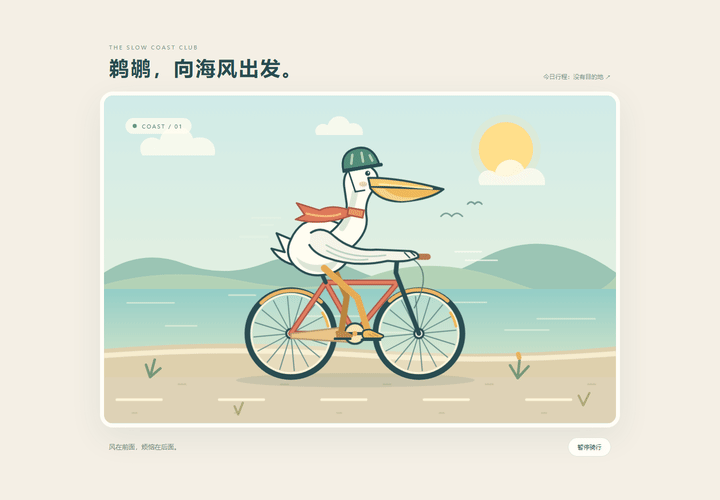
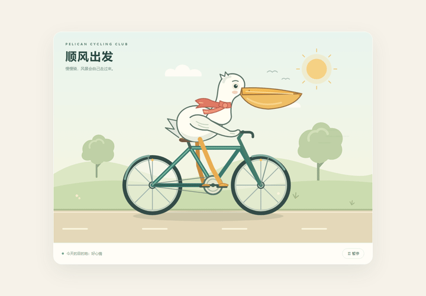
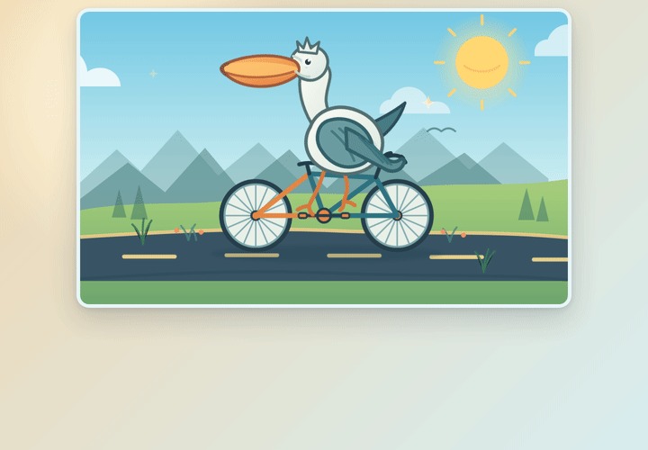

# Codex 突然变笨了？降智的快速自测与恢复方法

> 适用：感觉 Codex 生成质量明显下降、怀疑模型被替换的读者。
> 最后核对日期：2026-11-15。原教程记录于 2026-10-01，当前可用性尚未重新验证。

## 先说结论

- **降智**：你选择的 Astra、Sol 等大模型被替换成 Luna、GPT-5.5 mini 等小模型。
- **原因**：IP 频繁变动或纯净度不高（例如使用机场 IP）、订阅重新分发，以及其他违反 OpenAI 用户使用协议的行为被检测到后触发。
- **自测**：让模型生成「鹈鹕骑自行车」的 SVG 动画，对照下面三张实测 GIF。
- **恢复**：停止违规行为，将账号静置，等待系统动态重新评估。原作者的 20 倍 Pro 账号静置三天后恢复正常。

## 什么是降智

降智是指你选择的 Astra、Sol 等大模型被替换成 Luna、GPT-5.5 mini 等小模型。界面上档位名称可能不变，但实际生成能力明显下降。

## 为什么会降智

以下行为被检测到后会触发降智（原作者整理，客服确认降智是动态检测过程）：

- IP 频繁变动或纯净度不高，例如使用机场 IP；
- 订阅重新分发（把订阅额度转给他人使用的工具化用法）；
- 其他违反 OpenAI 用户使用协议的行为。

网络环境的自查与改善见 [网络环境要求](../guides/network-environment.md)。

## 如何检测：鹈鹕测试

用下面这段提示词让模型生成动画，主要看代码生成能力：

```text
创建一个 HTML，用 SVG 绘制鹈鹕骑自行车的 2D 动画。
不要参考任何其他文件。你不需要进行任何测试。
```

三个档位的实测效果对比（原作者录制，2026-10）：

| GPT-6 Astra / medium | GPT-6.1 Sol / high | GPT-5.6 Luna / max |
| --- | --- | --- |
|  |  |  |

判读方法（原作者的表述）：

- 你选的是 Astra、Sol，生成效果和**前两张图**差不多 → 没有被降智。
- 生成效果和**最后一张图**（Luna）差不多 → 你已经被降智了。

## 降智后如何恢复

原作者曾因降智与 OpenAI 客服沟通，客服反馈：**降智是一个动态检测过程**。

恢复思路：

1. 先停止所有违反 OpenAI 用户使用协议的行为（包括换回干净稳定的网络环境、停止订阅分发类用法）。
2. 将账号静置一段时间，等待系统重新评估。
3. 恢复正常后再按 [模型选择教程](./model-selection.md) 正常使用。

原作者的 20 倍 Pro 账号按这个方法处理，**静置三天后恢复正常**。这是原作者的个人案例，恢复时间因人而异，没有官方承诺的时限。

## FAQ

**Q：降智是永久的吗？**
A：按客服说法是动态检测过程，停止违规行为并静置后有机会恢复；原作者账号三天恢复。不保证所有账号都能恢复。

**Q：怎么区分「降智」和「任务本身太难」？**
A：用同一个鹈鹕测试提示词对照三张 GIF，比主观感受可靠。测试只考察代码生成能力，不能覆盖所有任务类型。

**Q：用中转站会降智吗？**
A：中转本身不必然触发降智，但「订阅重新分发」类用法属于违反协议的行为，被检测到会触发。中转的风险与性价比见 [周额度与中转性价比](./usage-and-limits.md)。

## 相关教程

- [Codex 模型与推理强度选择](./model-selection.md)
- [Codex 开通、二次验证与登录](./subscription-and-access.md)
- [Codex 周额度与中转性价比](./usage-and-limits.md)
- [网络环境要求](../guides/network-environment.md)

---

## 来源与修改说明

- 来源仓库：[chatgpt-plus-codex-cn-guide](https://github.com/cabbagecabbage/chatgpt-plus-codex-cn-guide)（cabbagecabbage，CC BY-NC-SA 4.0，商业使用已获授权）。
- 原始文档：`docs/model-quality-check.md`《Codex 降智：快速自测与解决方案》（2026-10-01 更新）及 README 第十四章。
- 修改情况：保留降智定义、原因、测试提示词、三组 GIF 对比与恢复经历；「楼主」改为「原作者」；原文「恭喜你已经被降智了」的调侃改为中性判读说明；「订阅重新分发（例如使用 sub2api）」改为行为描述，不介绍具体工具用法；补充恢复时间的个体差异说明。
- 图片来源：C 仓库 `docs/images/` 三张鹈鹕测试实测 GIF。
- 原教程记录日期：2026-10-01；本整合核对日期：2026-11-15。原教程记录于 2026-10-01，当前可用性尚未重新验证。