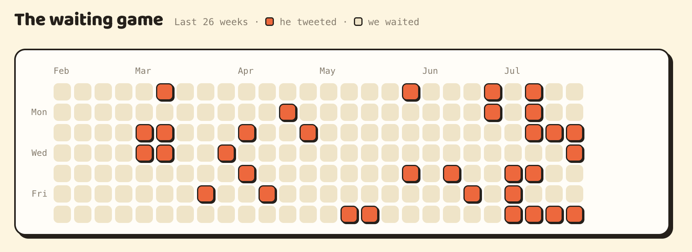
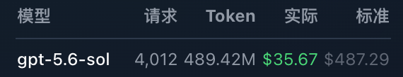

# Codex 周额度够用吗？官方 Plus 与中转站的性价比怎么算

> 适用：能把官方 Plus 的 Codex 周额度基本用满、在考虑「继续充官方还是用第三方中转」的读者。额度用不完时，应按实际用量重新计算。
> 最后核对日期：2026-11-16。本文数据为原作者 2026 年 3–8 月的实测统计，倍率与重置频率随时间变化，当前可用性尚未重新验证。

> **历史样本与当前官方口径分开看：** 下文的周额度倍数、API 等值金额与临界倍率，全部基于原作者 2026 年 3–8 月的历史统计和两个假设（Plus 月费按其实付 140 元人民币计、Plus 周额度按约 150 美元 API 等值估算），**不是官方公布的当前额度，也不代表额度可折算成现金价值**。官方额度规则此后已有调整（如 2026-10-29 Pro 三档 Work / Codex 额度翻倍）。按 [OpenAI 官方 Codex 定价页](https://learn.chatgpt.com/docs/pricing)（2026-11-16 核对）：Plus 的本地消息量按每 5 小时给出随模型不同的估算区间（官方注明「不是固定消息上限」），可能另有每周限额；**Pro 三档当前没有五小时限制**；实际用量以账号内面板（chatgpt.com/codex/settings/usage）或 CLI `/status` 为准。本文的计算方法（按自己实付金额与实际用量替换参数）仍然适用，但结论数字只对历史样本成立。

## 先说结论

按 2026 年 3–7 月的历史平均，官方 Plus 每月约享有 **9 倍周额度**（约 1,350 美元 API 等值用量）；Plus 月费按 140 元人民币计，**临界倍率约 0.1037 元/美元**——中转倍率低于这个数更划算，高于它不如自己充 Plus。

按用户类型直接给建议（原作者结论）：

| 用户类型 | 判断标准 | 建议 |
| --- | --- | --- |
| 重度用户 | 需要一个以上的 Plus 容量，能用满 | 中转倍率 `0.10` 及以下有性价比；超过 `0.10` 不如自己充 Plus |
| 轻度用户 | 一个 Plus 够用，经常用不完 | 先估算自己需要几倍周额度再查表；例如 4 倍就够用，`0.23` 及以下有性价比 |
| 超级重度用户 | 需要 10 个 Plus 以上的容量 | `0.05` 及以下；建议直接上 Pro 200（旧称 20x Pro），中转很难做到这个价格 |

> **先问自己：你真的有这么大用量吗？** 模型和推理强度会影响额度消耗，见 [模型与推理强度选择](./model-selection.md)。

## 统计口径：连续时间线，不按月切断

历史平均不按每个月月初重新切断，而是从选定起点连续追踪：

- 以 2026-03-01 `00:00` 作为第一次自然重置；
- 下一次自然重置按上一次重置之后 7 天计算；
- 如果 7 天到来前出现官方提前重置，就计入这次提前重置，并把下一次自然重置顺延到它之后 7 天；
- 一直统计到 2026-07-31 结束，不在 6 月 1 日、7 月 1 日人为再补一次自然重置。

重置日期依据 [Codex Resets](https://codex-resets.com/) 的记录人工核对。

### 2026 年 3–7 月：合计 45 倍周额度

| 月份 | 连续时间线中该月发生的重置次数（自然 + 官方提前） |
| --- | --- |
| 2026 年 3 月 | 9 倍 |
| 2026 年 4 月 | 8 倍 |
| 2026 年 5 月 | 7 倍 |
| 2026 年 6 月 | 8 倍 |
| 2026 年 7 月 | 13 倍 |
| **合计** | **45 倍** |



按 5 个月折算，平均每月：

```text
45 ÷ 5 = 9 倍周额度
9 × 150 美元 = 1,350 美元 API 等值用量
```

其中「Plus 周额度 ≈ 150 美元 API 等值用量」为原作者采用的估算口径。

### 历史平均临界倍率

Plus 月费按 `140 元人民币` 计算（原作者实际支付口径，不同订阅路线的人民币成本不同，请按自己的实付金额替换）：

```text
140 元 ÷ 1,350 美元 ≈ 0.1037 元/美元
```

额度能基本用满时，中转倍率低于 `0.1037` 更划算；用量不足时按实际用量重新计算。

## 单月高峰案例：2026 年 7 月 14 倍

7 月是官方提前重置非常密集的特殊月份，单独按 7 月 1 日 `00:00` 重新起算展示高峰情况，**不替代历史平均口径**：

| 时间段或事件 | 计入额度 |
| --- | --- |
| 7 月 1 日 ～ 7 月 8 日 | 1 倍 |
| 7 月 8 日 ～ 7 月 9 日第一次官方提前重置前 | 1 倍 |
| 7 月内 12 次官方提前重置 | 12 倍 |
| **合计** | **14 倍** |

```text
14 × 150 美元 = 2,100 美元 API 等值用量
140 元 ÷ 2,100 美元 ≈ 0.0667 元/美元
```

| 中转倍率 | 购买 2,100 美元等值用量的成本 | 结论 |
| --- | --- | --- |
| `0.03` | 63 元 | 中转更划算 |
| `0.06` | 126 元 | 中转更划算 |
| `0.0667` | 约 140 元 | 临界点 |
| `0.07` | 147 元 | Plus 更划算 |
| `0.08` | 168 元 | Plus 更划算 |

### 2026 年 8 月进度（未完成月份，不作最终结论）

截至 2026-08-01，8 月已实际享有 2 倍周额度；即使后续不再提前重置，按月度口径整月至少 6 倍。最终结果要等月底完整记录确认——**不能把未完成月份的进度当整月结果，也不能拿它替代历史平均。**

## 按自己的实际需求查表

先估算自己实际需要多少倍周额度，再查换算表：

```text
Plus 临界倍率 = 140 ÷ (实际周额度倍数 × 150)
20x Pro 理论临界倍率 = Plus 临界倍率 ÷ 2
```

完整自然月正常至少有 4 倍周额度；1～3 倍供低用量用户按实际需求查表。

| 实际周额度倍数 | API 等值额度（美元） | Plus 临界倍率 | 20x Pro 理论临界倍率 |
| --- | --- | --- | --- |
| 1 | 150 | `0.9333` | `0.4667` |
| 2 | 300 | `0.4667` | `0.2333` |
| 3 | 450 | `0.3111` | `0.1556` |
| 4 | 600 | `0.2333` | `0.1167` |
| 5 | 750 | `0.1867` | `0.0933` |
| 6（2026 年 8 月至少） | 900 | `0.1556` | `0.0778` |
| 7 | 1,050 | `0.1333` | `0.0667` |
| 8 | 1,200 | `0.1167` | `0.0583` |
| 9（2026 年 3～7 月连续平均） | 1,350 | `0.1037` | `0.0519` |
| 10 | 1,500 | `0.0933` | `0.0467` |
| 11 | 1,650 | `0.0848` | `0.0424` |
| 12 | 1,800 | `0.0778` | `0.0389` |
| 13 | 1,950 | `0.0718` | `0.0359` |
| 14（2026 年 7 月实际） | 2,100 | `0.0667` | `0.0333` |
| 15 | 2,250 | `0.0622` | `0.0311` |

### 20x Pro 理论参考

> 「20x Pro」是 2026-10-29 额度翻倍前的旧称，现对应 **Pro 200（200 美元/月）**；「月费是 Plus 的 10 倍、周额度约 20 倍」中的倍数是 Codex 负责人 Tibo 在 X 上的说明，不是官方定价页公布的固定承诺（出处见 [ChatGPT 套餐选择](../chatgpt/plus-vs-pro.md)）。下表是按该理论口径推算的参考值，不是官方数据。

按「月费是 Plus 的 10 倍、周额度是 20 倍」的理论口径，20x Pro 的临界倍率正好是 Plus 的一半：按 3–7 月平均 9 倍计约 `0.0519`，按 7 月实际 14 倍计约 `0.0333`。

但 **Pro 更难在每次重置前把额度用满**。实际用量不足时，应按「月费 ÷ 实际用量」重新计算，真实临界倍率会高于表中理论值。

## 原作者使用记录（2026 年 7–8 月，持续更新的个人体验）

以下基于原作者个人使用情况，实际体验因账号、用量和线路波动而不同：

- **7 月 21 日**：`0.05` 倍率线路不稳定，使用时出现断联；切换到 `0.08` 倍率线路后恢复正常。
- **7 月 22 日**：用 `0.08` 倍率线路跑了一宿任务，将近 5 亿 Token，花了 30 多块钱；早上发现降价到 `0.03`，切换后不久 `0.03` 组又涨到 `0.06`——中转价格变动非常快。

  

- **7 月 27 日**：主要使用官方 Plus；中转倍率在 `0.07～0.1` 之间波动。每次都能在额度刷新前稳定用完周额度，当月截至当时已额外重置 10 次。中转主要用于 Plus 额度用完后的兜底。原作者提醒：如果你 Token 用量少、用不完 Plus 额度，中转可能仍然更划算，按自己的实际用量估算后再决定。
- **8 月 1 日**：7 月整月 Codex 官方共提前重置 12 次，8 月 1 日当天又提前重置 1 次。
- **8 月 6 日**：中转用得少了，主要用官方 Plus，暂未再遇到 Codex 登录掉线或二次验证；近期中转上的 Luna 不太好用，继续观察。

原作者后期的组合是「**20 倍 Pro 主力、中转兜底**」：优先用 Pro 额度，用完再切中转。

## 用中转前必须知道的风险

- 中转站是**第三方服务，不是 OpenAI 官方渠道**：你的请求数据经过第三方服务器，稳定性、价格、跑路风险都由平台决定。
- 倍率随时波动（原作者一夜间经历 `0.08 → 0.03 → 0.06`），低价线路可能断联。
- 「订阅重新分发」类用法违反 OpenAI 用户使用协议，可能触发降智等风控，见 [降智自测与恢复](./troubleshooting.md)。
- 本文不推荐任何具体中转站；原作者自用中转的邀请返利链接已移除。

## 相关教程

- [Codex 开通、二次验证与登录](./subscription-and-access.md)
- [Codex 模型与推理强度选择](./model-selection.md)
- [Codex 降智自测与恢复](./troubleshooting.md)
- [ChatGPT Free / Go / Plus / Pro 怎么选](../chatgpt/plus-vs-pro.md)

---

## 来源与修改说明

- 来源仓库：[chatgpt-plus-codex-cn-guide](https://github.com/cabbagecabbage/chatgpt-plus-codex-cn-guide)（cabbagecabbage，CC BY-NC-SA 4.0，商业使用已获授权）。
- 原始文档：`docs/plus-relay-cost-analysis.md`《Codex 周额度理论倍率、临界倍率与中转站性价比对比：详细计算》（2026-11-09 更新）、README 第十二章结论表与附录使用记录。
- 修改情况：保留全部统计口径、数据表、公式与使用记录；「楼主」改为「原作者」；**删除第十一章 zz-api.cc.cd 中转站邀请返利链接（aff 推广）**，改为中立的中转风险提示；补充「140 元为原作者实付口径」「150 美元为估算口径」的说明，避免被当作官方定价。2026-11-16 复核：文首补充历史样本声明与当前官方额度口径（Plus 每 5 小时估算区间、Pro 无五小时限制、用量面板入口，按官方 Codex 定价页核对）；「20x Pro」标注为旧称并对应 Pro 200，理论倍数标注为 Tibo 个人说明而非官方承诺；历史统计数据本身未改动。
- 图片来源：C 仓库 `docs/images/` 重置记录与中转用量截图 2 张。
- 原教程记录日期：2026-03 至 2026-08（统计与使用记录），文档最后更新 2026-11-09；本整合核对日期：2026-11-15，2026-11-16 按官方定价页复核口径说明。原教程记录于上述日期，当前可用性尚未重新验证。