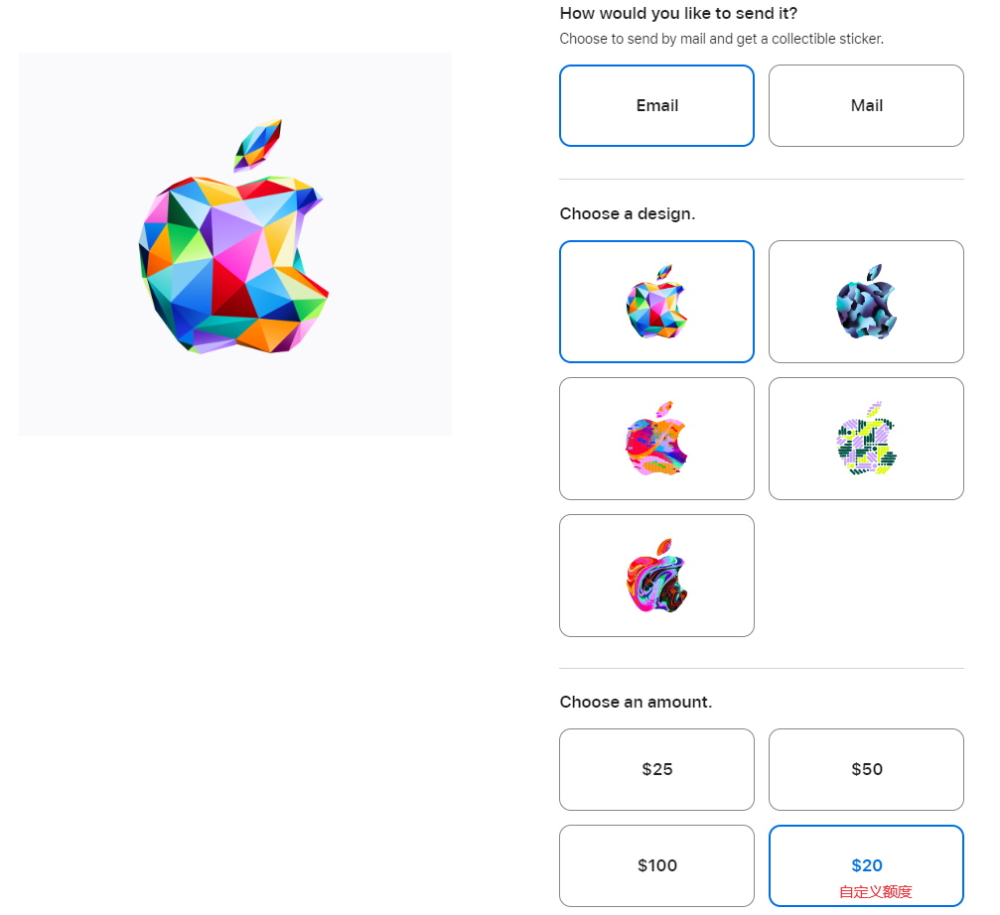
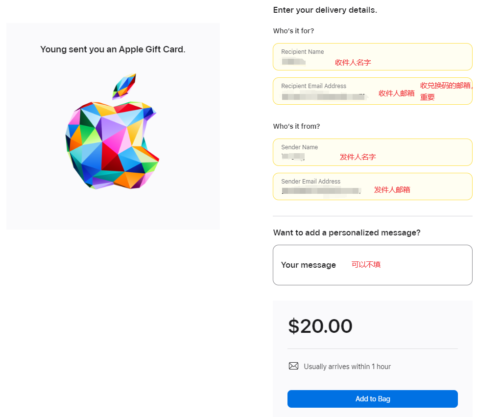
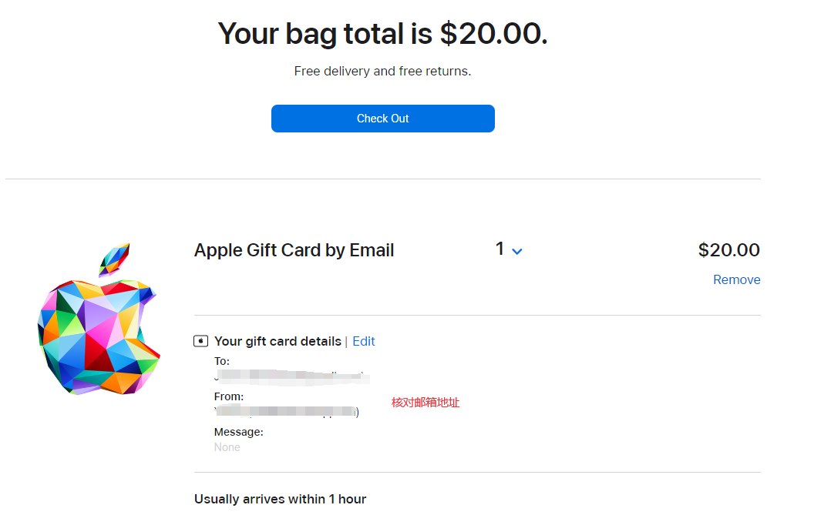
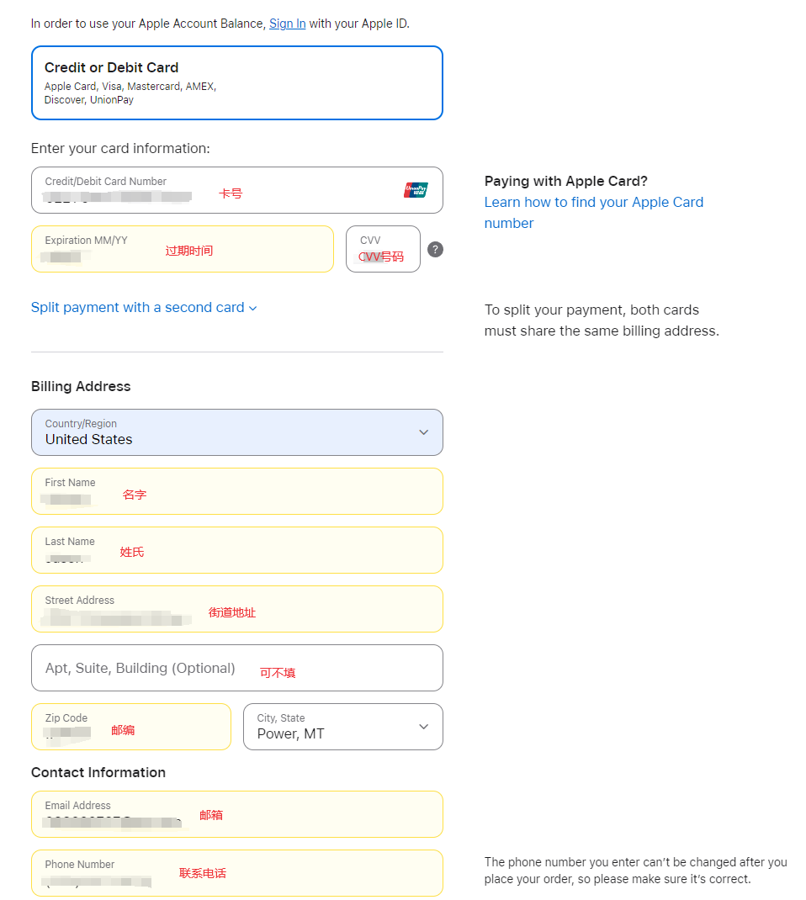
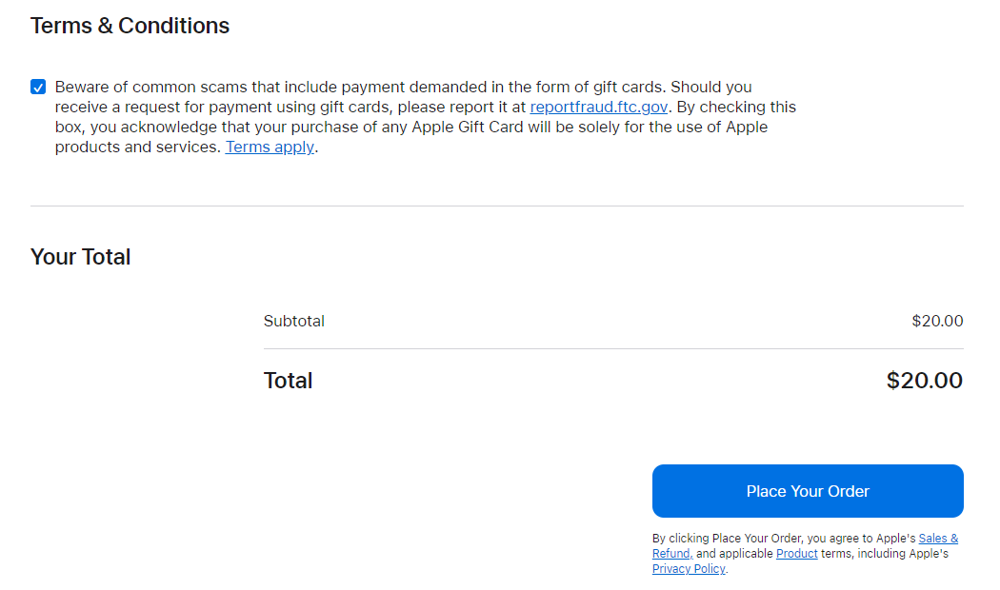
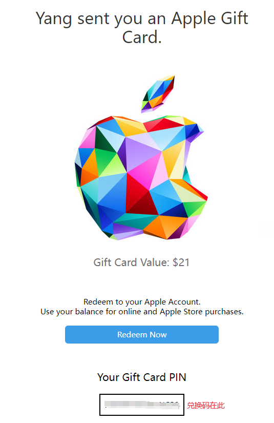
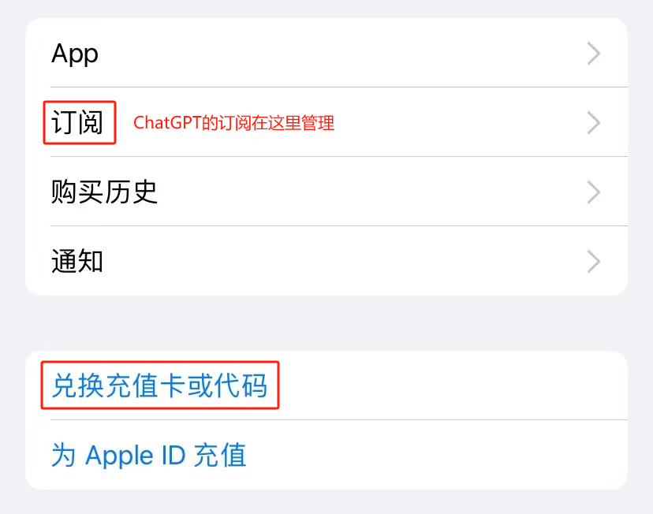
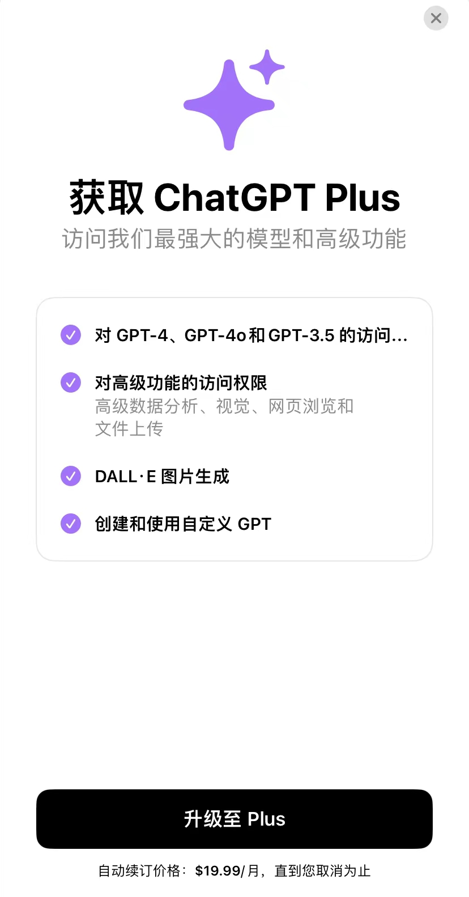

# 怎么在 Apple 官网买美区礼品卡？国内银联卡也能付

> 适用：有国内银联卡（储蓄卡或信用卡）、想在 Apple 官方商店直接购买美区 Apple Gift Card 的用户。
> 核心流程来自 Way-to-ChatGPT-Plus 的图文实测；最后核对日期 2026-11-15。原教程记录于 2025-06-20，当前可用性尚未重新验证，付款时以 Apple 页面实际提示为准。

## 先说结论

在 [Apple 官网礼品卡页面](https://www.apple.com/shop/buy-giftcard/giftcard) 选 Email  delivery、填 $20 面额和自己的收件邮箱，结算时选 Credit or Debit Card，**填入国内银联卡的卡号、有效期和 CVV**，账单地址填美国免税州地址，即可下单。原作者实测一小时内收件邮箱收到兑换码。

这条路线买的是 **Apple 官方发行的礼品卡**，来源最正规；缺点是 Apple 官网是否接受某张银联卡、以及风控是否放行，以实际结算结果为准，原作者的记录不代表当前一定成功。

## 准备什么

1. 一张国内银联卡（原作者使用的是银联账户）。
2. 一个美区 Apple ID 和美国免税州地址（见 [注册美区 Apple ID](./apple-id-registration.md)）。
3. 自己能登录的收件邮箱。
4. 建议全程使用美国节点的网络环境。

## 购买步骤（附原作者截图）

### ① 进入官网礼品卡页面，选 Email 和面额

前往 [Apple 官网礼品卡页面](https://www.apple.com/shop/buy-giftcard/giftcard)。邮寄方式选择 **Email**，面额选择右下角自定义，填入 **20**（或者 19.99，iOS 端订阅可以节省 $0.01）。

### ② 填收件人和发件人信息

填入收件人的名字和邮箱、发件人的名字和邮箱，**一定要使用自己能登录的邮箱地址**，然后点击 Add to Bag。

### ③ 检查邮箱，Guest 结算

检查邮箱地址无误后 Check Out。不使用 Apple Card 支付的话，直接点击 **Guest** 访问。

### ④ 选 Credit or Debit Card，填银联卡

选择 **Credit or Debit Card** 支付，填入银联账户的卡号、过期时间和 CVV 码。下面地址栏填入之前准备的美国地址和联系方式。**再次强调一定要填免税州的地址，不然会被收税。**

### ⑤ 下单，保存订单号

勾选同意后下订单，在下一个页面可以看到订单号，点击进入后可以查看订单进度。

### ⑥ 收邮件，取兑换码

原作者实测：一小时内，收件人邮箱内就能收到邮件，框里面就是兑换码，把它复制到手机上。

*截图来源：Way-to-ChatGPT-Plus（farion1231）。*

### ⑦ 兑换并订阅

在 **App Store** 里登录美区账号（注意一定**不要**在系统设置里登录整个 iCloud），点击右上角头像，选择**兑换充值卡或代码**，将兑换码复制进去充值，成功后可以在账户界面看到余额。最后打开 ChatGPT App，点击 Plus 订阅，输入 Apple ID 密码就能成功订阅。取消订阅在 App Store 的「订阅」里操作，Claude 同理。

完整兑换与内购细节见 [礼品卡兑换教程](./apple-gift-card-redemption.md) 和 [ChatGPT iOS 订阅教程](../chatgpt/subscribe-ios.md)。

## 另一来源的官方商店步骤（对照）

chatgpt-plus-subscription-guide（2026-09-10 核对）给出的流程一致，可作对照：

1. 进入对应地区的 Apple 官方商店，找到 Apple Gift Card。
2. 选择通过 Email 发送。
3. 填写面额、自己的收件邮箱和基本信息。
4. 加入购物袋并进入结算页。
5. 使用 Apple 页面接受的付款方式付款。
6. 付款后保存订单号，等待礼品卡邮件。

## 面额建议：$20 还是 $22？

- 主流做法是买 **$20**：iOS 内购 Plus 为 $19.99，账单州设为免税州（Oregon / Montana 等）不加税，$20 刚好够，付完剩 $0.01。
- 另一来源（GetClaudeProByAppleIO）提醒：即使是免税州的美区 Apple Store 账号，通过 App Store 订阅时**有时会扣款 $21**，保险起见可以购买 $22 面额的礼品卡余额。原教程记录于 2026-10-06，当前可用性尚未重新验证；是否多买 $2 由你自己权衡。

## 风险提示

- **Apple ID 和 ChatGPT / Claude 账号一定要自己注册，千万不要购买批量注册的账号，不然付费后封号的风险非常高。**（原作者反复强调）
- ChatGPT、Claude 对网络节点质量要求比较高，请尽量使用稳定的高质量节点，见 [网络环境要求](./network-environment.md)。
- Claude 风控很严格，原作者建议新注册的账号先使用一段时间再考虑订阅 Pro。
- 银联卡能否在 Apple 美区官网结算成功，取决于 Apple 与发卡行的实际校验；被拒时不要反复重试，可改用 [Pockyt](./apple-gift-card-pockyt.md) / [SEAGM](./apple-gift-card-seagm.md) 等支付宝渠道。

## 相关教程

- [支付宝买美区礼品卡（Pockyt）](./apple-gift-card-pockyt.md)
- [SEAGM 买美区礼品卡](./apple-gift-card-seagm.md)
- [礼品卡兑换与失败排查](./apple-gift-card-redemption.md)
- [注册美区 Apple ID](./apple-id-registration.md)

---

## 来源与修改说明

- 来源仓库：[Way-to-ChatGPT-Plus](https://github.com/farion1231/Way-to-ChatGPT-Plus)（farion1231，Apache-2.0）；[chatgpt-plus-subscription-guide](https://github.com/daydayup-xq/chatgpt-plus-subscription-guide)（daydayup-xq，CC BY 4.0）；[GetClaudeProByAppleIO](https://github.com/sunreview/GetClaudeProByAppleIO)（sunreview，无许可证，经项目负责人确认授权，仅取面额建议与 FAQ）。
- 原始文档：W `使用美国区Apple ID订阅.md`「购买礼品卡」节；D README 方法二「通过 Apple 官方商店购买」段；S README 礼品卡面额提醒。
- 修改情况：保留原作者全部步骤与截图顺序；「科学上网」统一表述为「美国节点网络环境」；删除 S 来源中的成品号店铺、礼品卡店铺等全部商业推广链接；补充日期标注与导航。
- 图片来源：W 仓库 `imgs/card1-7.png`、`imgs/card8.jpg` 共 8 张。
- 原教程记录日期：2025-06-20（W）、2026-09-10（D）、2026-10-06（S）；本整合核对日期：2026-11-15。当前可用性尚未重新验证。