# 支付宝怎么买美区 Apple 礼品卡？Pockyt Shop 六步实测流程

> 适用：有 iPhone / iPad，准备用美区 Apple ID + 礼品卡余额订阅 ChatGPT Plus、Claude Pro 等应用的用户。
> 核心流程来自原作者 2026 年 7 月至 11 月的多次实测；最后核对日期 2026-11-15。价格、汇率和库存随时变化，付款时以页面显示为准。

## 先说结论

在支付宝里把定位切到美国城市，通过「大牌礼卡」活动页进入 **Pockyt Shop**，选美区 App Store & iTunes 礼品卡，支付宝人民币付款，付款后页面或邮箱直接给兑换码。原作者实测：$20 卡 2026-07-18 实付 ¥135.98，2026-10-13 复测 ¥134.44；2026-11-12 买 $100 卡实付 ¥670.43。

**先分清两种礼品卡：** 本文买的是 **Apple Gift Card → Apple 账户余额 → ChatGPT iOS 订阅**。OpenAI Gift Card 则兑换到 **ChatGPT Wallet**，用于符合条件的网页结账，且仅限美国购买和兑换（[OpenAI 官方说明](https://help.openai.com/en/articles/20001491-buying-and-redeeming-openai-gift-cards)）。两者不通用，详见 [三种礼品卡的区别](./apple-gift-card-redemption.md#先分清三种礼品卡)。

## Pockyt Shop 是谁

美国支付公司 Pockyt 开的礼品卡商店。Pockyt 2017 年成立，总部在纽约，原名 Yuansfer，做线上线下收款，商家用它接支付宝、PayPal 等主流电子钱包付款，拿过 500 万美元种子轮融资（[2022 年 1 月的新闻稿](https://www.globenewswire.com/news-release/2022/01/13/2366358/0/en/Leading-Payments-Platform-Pockyt-Announces-Partnership-With-Delaware-North-Enabling-Contactless-QR-Code-Payments-For-Consumers-Using-Alipay-PayPal-and-Other-Popular-Digital-Wallets.html)）。[Pockyt 官网](https://pockyt.io)写明，公司主体 Yuansfer, Inc.（NMLS #2126922）在所列的美国各州持牌或获准经营汇款业务；在支付宝买卡，账单上的收款方写的也是 Yuansfer Inc。

Pockyt Shop 的[礼品卡条款](https://shop.pockyt.io/terms)（2022 年 10 月 8 日更新）写明：礼品卡由合作的零售商提供和兑现，**卖出后不退**（购买出错没买成的除外），客服可通过其官网联系，地址在纽约华尔街 40 号。

> Pockyt 是第三方礼品卡零售商，不是 Apple 或 OpenAI 的官方授权充值渠道。

## 实测成本记录（汇率参考与实际付款分开看）

| 项目 | 核对结果 |
| --- | --- |
| 即时汇率参考（2026-07-18 17:09 UTC） | $19.99 ≈ ¥135.40 |
| Pockyt 实际成交（2026-07-18） | $20 美区礼品卡实付 ¥135.98，汇率 1 USD = 6.81244 CNY |
| Pockyt 付款页复测（2026-10-13 02:40 北京时间） | 同一张卡 ¥134.44，汇率 1 USD = 6.73527 CNY，订单金额 $19.96 |
| Pockyt 实际成交（2026-11-12 22:10 北京时间） | $100 美区礼品卡实付 ¥670.43，汇率 1 USD = 6.70434 CNY，订单金额 $100.00 |
| ChatGPT iOS 内购（账单州 Oregon） | $19.99，无额外销售税 |
| 付款后余额 | 兑换 $20 后支付一个月，Apple ID 余额剩 $0.01 |

以上为原作者的历史实测记录，**不是当前报价**；汇率会变化，购买时以 Pockyt 和 App Store 页面显示为准。

## 支付宝买卡：6 步实测流程

这六步都在支付宝里完成，人民币付款；之后再到 App Store 兑换并订阅。

**入口说明（2026-10-28 实测）：** 支付宝首页的活动位会跟着活动换。这次的入口在首页「超值抢购」里，卡片标着「秋季限定」，活动结束后可能又会换位置。以前的入口是底部「Coupons」→「大牌礼卡」，Pockyt Shop 首页的横幅上现在还是这样写的（「优惠」菜单 → 大牌礼卡），首页找不到时可以再试试。两处都找不到，直接用下面的[直达链接](#找不到入口用直达链接)。进了 Pockyt Shop，先点右上角的星标收藏（第 ⑥ 步），以后入口再换也不用重新找。

### ① 切美国城市，点「大牌礼卡低至9折」

支付宝**左上角**把定位切到**美国任意城市**（截图里是洛杉矶），在首页**「超值抢购」**里点**「大牌礼卡低至9折」**。

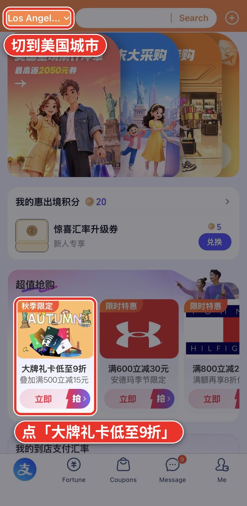

> 注意：在支付宝切换到美国城市，只是为了在首页找到礼品卡入口，**不会改变你的支付宝账户地区**，也不影响 Apple ID 的地区。

### ② 活动页滑到最底部

进入「大牌礼卡 枫享好礼」活动页，**一直往下滑到最底部**。

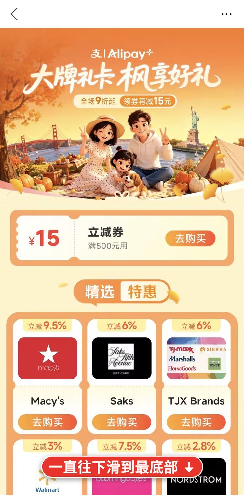

### ③ 点 Pockyshop

在最底部的「更多大牌 折扣礼卡」里点 **Pockyshop**。

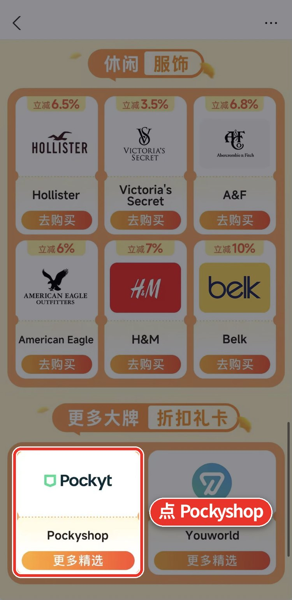

### ④ 地区选美国，选 App Store & iTunes USA

进入 Pockyt Shop，**地区选美国**，点 **App Store & iTunes USA**（卖完了就点旁边的 **Apple Gift Card**），填收码邮箱、选面额。**直接选 $20，别卡着 $19.99**——iOS 内购 Plus 是 $19.99，账单州 Oregon 不加税，$20 刚好够。

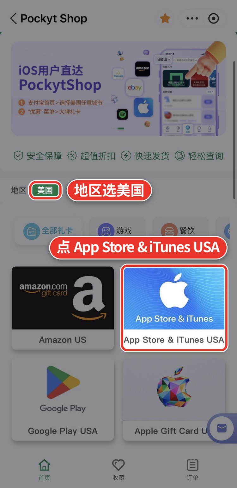

### ⑤ 支付宝付款

支付宝付款：$20 礼品卡 ¥134.44（2026-10-13 复测；7 月实付 ¥135.98），汇率透明。

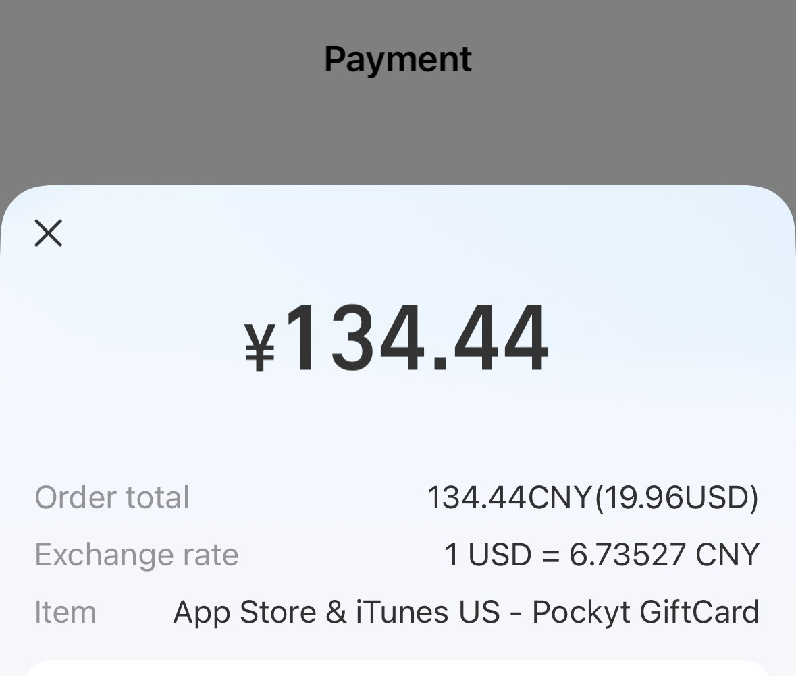

### ⑥ 收藏 Pockyt Shop

点 Pockyt Shop 右上角的 **★**。以后活动入口换了或者下线了，从支付宝的收藏里还能直接打开。

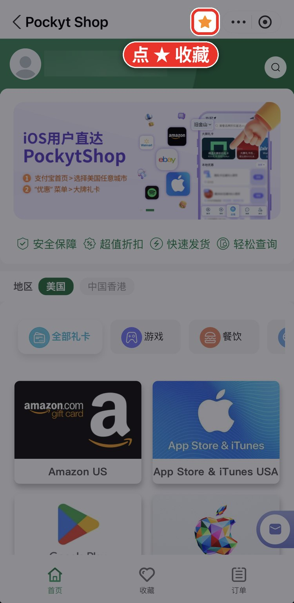

*以上截图来源：chatgpt-plus-china-guide（Avarce），2026-10-13 / 10-28 实测。*

买好以后，到 [App Store 兑换礼品卡](./apple-gift-card-redemption.md)，再到 [iOS 版 ChatGPT 订阅 Plus](../chatgpt/subscribe-ios.md)。还没有美区 Apple ID 的话，先[注册一个](./apple-id-registration.md)。

## 找不到入口？用直达链接

2026 年 10 月 9 日有读者在原仓库 Issue #1 反馈：支付宝切到美国城市后，界面里找不到「大牌礼卡」，搜索也搜不到 Pockyt。遇到这种情况，跳过第 ①–③ 步，用链接直接进 Pockyt Shop：

```
https://ur.alipay.com/_5pdWVYNxT2sYKHaPeYkNZh
```

1. 复制上面的链接，粘贴到支付宝**顶部搜索框**，点结果里的**访问网页**。
2. 直接进入 Pockyt Shop。**地区选美国**，点 **App Store & iTunes**，再填邮箱、选面额并付款，同第 ④、⑤ 步。

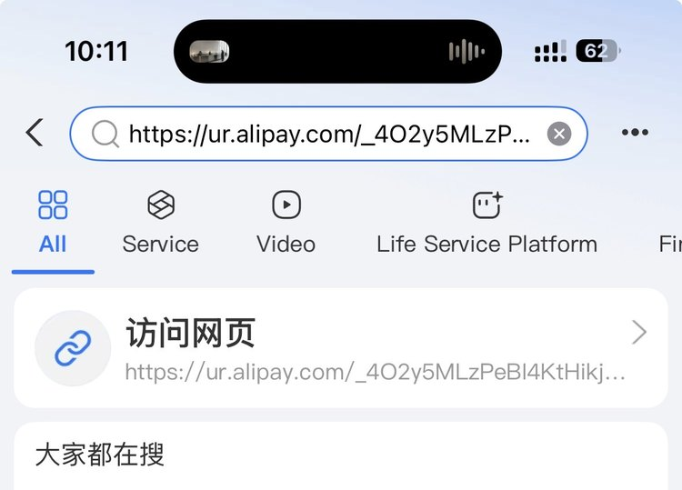

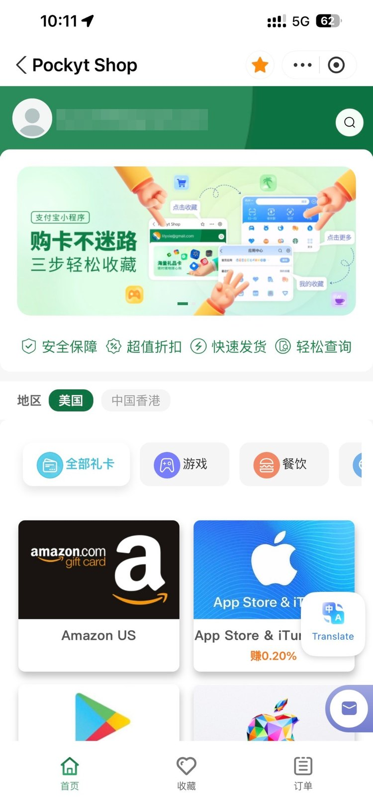

这条链接是 2026 年 10 月 9 日给出的，要粘贴到支付宝里打开。进去以后同样点右上角的星标收藏。链接失效时，可改用[电脑官网](#用电脑买pockyt-shop-官网)或[备用渠道 SEAGM](./apple-gift-card-seagm.md)。

## 用电脑买：Pockyt Shop 官网

Pockyt 客服邮件里写的官方网站是 [shop.pockyt.io](https://shop.pockyt.io)，用电脑操作更方便。原作者 11 月 6 日打开看过：右上角登录 / 注册，左上角地区选美国，在「全部礼卡」里点 App Store & iTunes USA（卖完了就点 Apple Gift Card，11 月 12 日看过电脑版也有），输入面额 USD 20，付款方式里有支付宝和微信支付。**网页版原作者没有实测付款**，流程和支付宝里买大致一样。

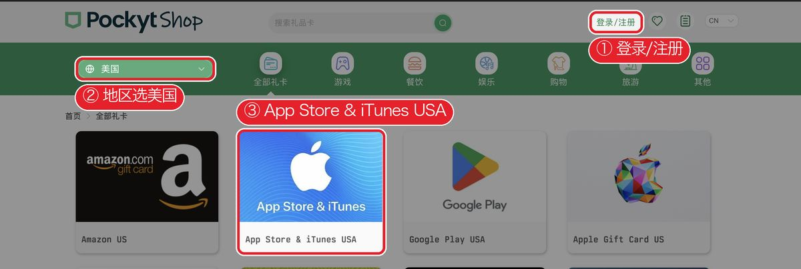

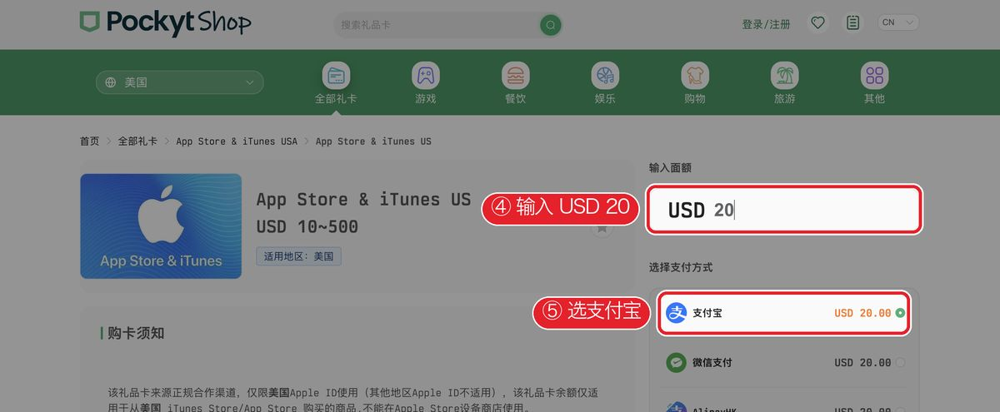

*截图来源：chatgpt-plus-china-guide（Avarce），2026-11-06。*

## Pockyt 缺货怎么办：库存时间线与备用渠道

原作者记录的库存变化（均为 2026 年）：

| 日期 | 状态 | 来源 |
| --- | --- | --- |
| 10 月 22 日 | 在售：固定面额 $10–200，另有 $2~500 自选 | 原作者打开看过 |
| 10 月 28 日 | 读者按新入口买到礼品卡、充值成功 | 原仓库 Issue #1 |
| 11 月 4 日 | 缺货，客服当晚回复已补货 | Issue #1 读者反馈 |
| 11 月 5 日 | 又卖完了，客服回复**暂无明确的补货时间** | Issue #1 读者反馈 |
| 11 月 6 日 | **已补货**：客服中午回信「现已到货，可以正常下单购买」，当天打开核实有货 | 客服回信截图 |
| 11 月 12 日 | **在售**：App Store & iTunes 卖完了，旁边的 **Apple Gift Card** 有货。原作者用支付宝买了一张 $100 美区卡，一次付款成功，付款后页面直接显示兑换码 | 原作者实测 |

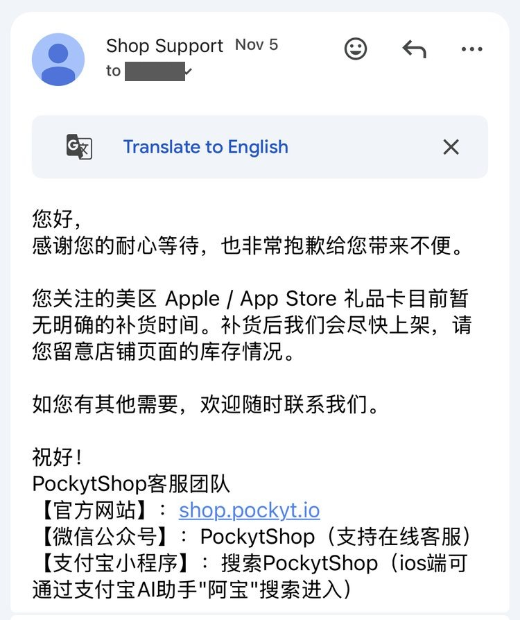

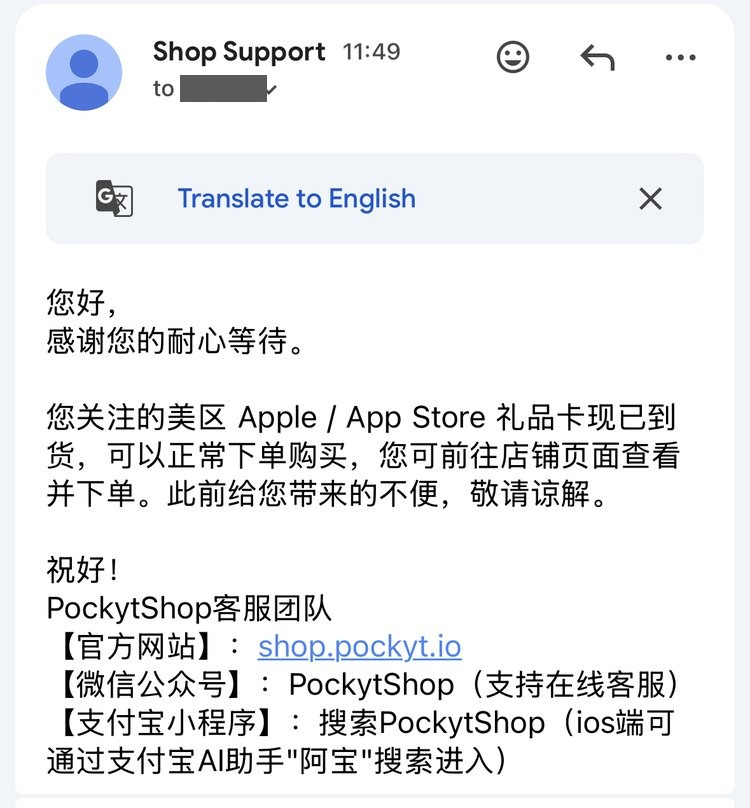

*客服截图来源：chatgpt-plus-china-guide（Avarce）；截图中的商家标识已遮挡。*

11 月 12 日实测付款成功页与支付宝账单：

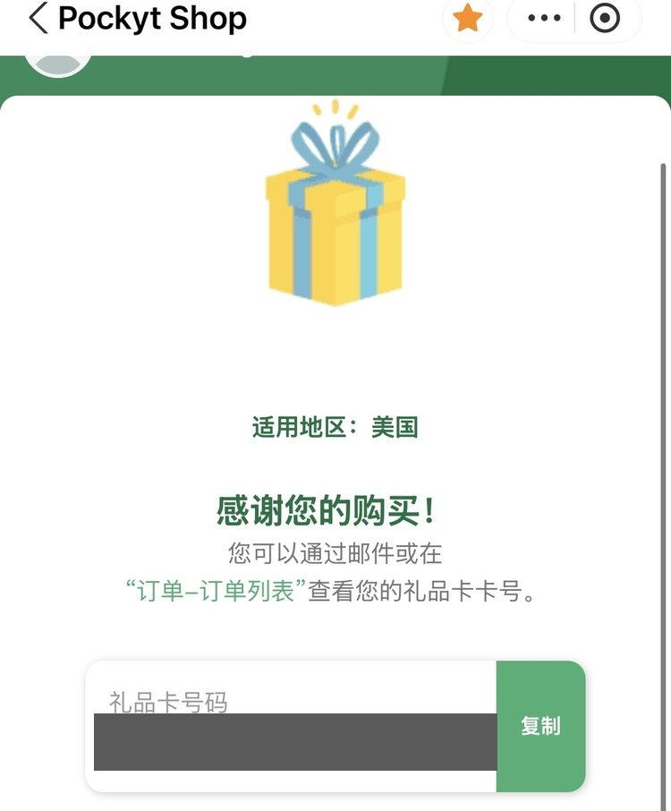

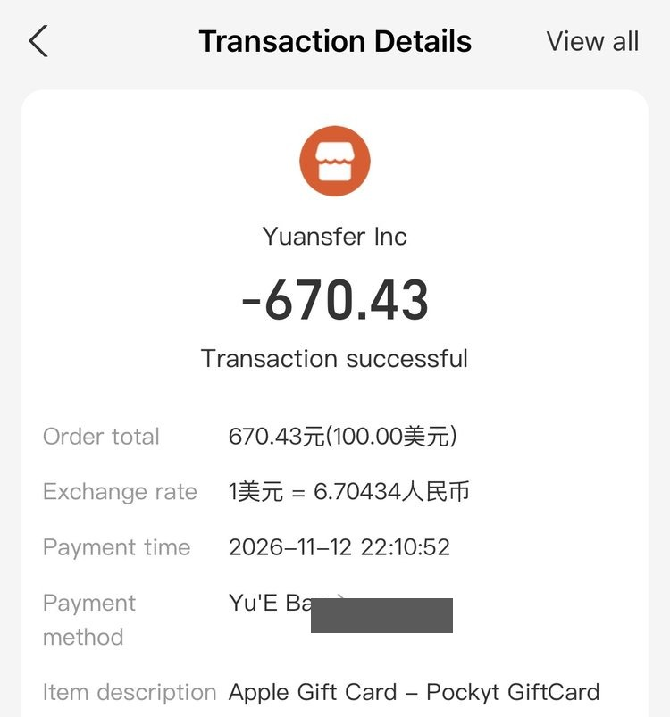

*截图来源：chatgpt-plus-china-guide（Avarce），2026-11-12。兑换码、精确付款时间等敏感信息已遮挡；图中礼品卡已被原作者兑换。*

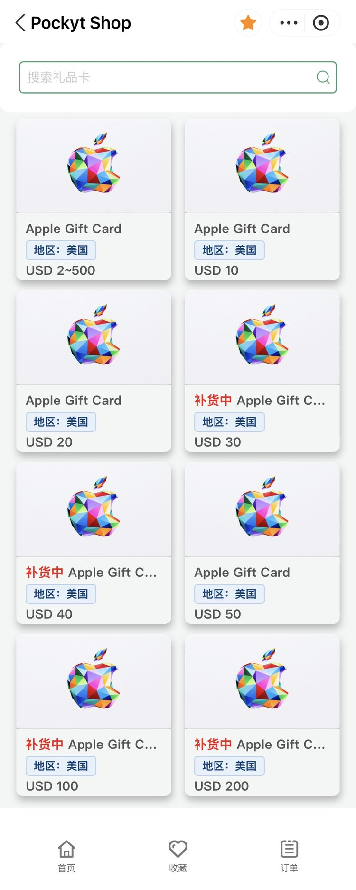

*支付宝里的 Pockyt Shop 商品页（2026-11-12 截图）：地区选美国，App Store & iTunes 卖完时，可以买旁边的 Apple Gift Card。面额可以自己填（$2~500），也有 $10–200 几档固定面额，订 Plus 选 $20 就够。*

**再遇到缺货：** 可以用[备用渠道 SEAGM](./apple-gift-card-seagm.md)，同样能用支付宝买苹果美区礼品卡（原作者 11 月 6 日实测）。补货时间可以在微信公众号 PockytShop 里找在线客服问。

另一来源（chatgpt-plus-codex-cn-guide，2026-11-09 更新）还记录了一个更早的入口：支付宝首页左上角地区选**旧金山**，点**礼品卡**，跳转后首屏可见 Apple 礼卡入口；并提醒**每月月初约前 5～7 天可能显示补货中无法购买**。入口随活动变化，找不到时用上面的直达链接。

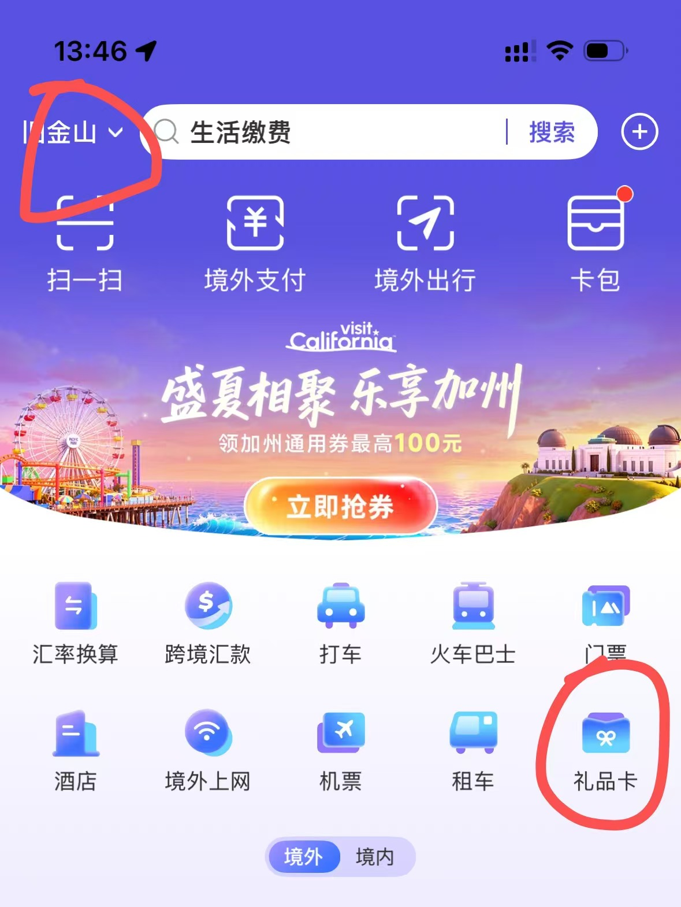

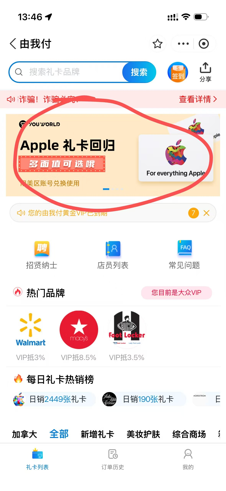

*截图来源：chatgpt-plus-codex-cn-guide（cabbagecabbage）。*

## 买卡渠道怎么选

- **推荐：** 有公司主体、运营多年、能用支付宝付款的平台。原教程实测过两家：Pockyt（本文）和 [SEAGM](./apple-gift-card-seagm.md)。来源可查，比淘宝/闲鱼的低价卡密稳得多。
- **不推荐：** 淘宝/闲鱼上明显低于面值的卡密，来源查不到。按 Apple 的[礼品卡条款](https://www.apple.com/legal/internet-services/itunes/giftcards/us/terms.html)，Apple 怀疑礼品卡来路不正时，可以作废这张卡、不退款，也可以停用账户。

## 常见问题

**Q：买完多久拿到兑换码？**
A：原作者 11 月 12 日实测付款后页面直接显示兑换码；兑换码也会发到下单时填的邮箱。没收到邮件，在 Pockyt Shop 底部的「订单」里能看到购买记录和兑换码。

**Q：买错了面额或地区能退吗？**
A：按 Pockyt Shop 条款，礼品卡卖出后不退（购买出错没买成的除外）。下单前核对地区必须是美国。

**Q：订 Plus 买多大面额？**
A：$20 就够（iOS 内购 $19.99，Oregon 账单州无税）。第一次购买建议只买够一个月使用的金额，不要一开始就在账户里存很多余额。

## 相关教程

- [SEAGM 买美区礼品卡（缺货备用，19 步实测）](./apple-gift-card-seagm.md)
- [Apple 官网买礼品卡（银联卡可付）](./apple-gift-card-official.md)
- [礼品卡兑换与失败排查](./apple-gift-card-redemption.md)
- [注册美区 Apple ID](./apple-id-registration.md)
- [ChatGPT iOS 订阅完整流程](../chatgpt/subscribe-ios.md)

---

## 来源与修改说明

- 来源仓库：[chatgpt-plus-china-guide](https://github.com/Avarce/chatgpt-plus-china-guide)（Avarce，无许可证，经项目负责人确认授权）；[GPTplusSub](https://github.com/laoma528/GPTplusSub)（laoma528，无许可证，经项目负责人确认授权，`alipay-apple-gift-card.html` 的直达链接与入口说明）；[chatgpt-plus-codex-cn-guide](https://github.com/cabbagecabbage/chatgpt-plus-codex-cn-guide)（cabbagecabbage，CC BY-NC-SA 4.0，已获商业授权，第七章入口与补货提醒）。
- 修改情况：保留原作者全部实测步骤、价格记录与日期；删除原仓库的商家充值服务推广（AONIR 价格表与外链）；内部锚点改为本站相对链接；将「我们实测」等表述改为「原作者实测」，避免冒充本站实测。
- 图片来源：A 仓库 Pockyt 相关 15 张截图（其中兑换码、精确付款时间、客服截图中的商家标识已遮挡）；C 仓库支付宝入口 2 张。
- 原教程记录日期：2026-07-18 至 2026-11-12（A）、2026-11-14（L）、2026-11-09（C）；本整合核对日期：2026-11-15。价格与库存为历史记录，当前可用性尚未重新验证。