# SEAGM 怎么买美区 Apple 礼品卡？支付宝付款 19 步实测

> 适用：Pockyt 缺货时的备用渠道，或习惯在网页购买礼品卡的用户。需要 iPhone / iPad 和同地区（美区）Apple ID。
> 核心流程来自原作者 2026-11-06 凌晨的完整实测（注册 → 付款 → 兑换成功）；最后核对日期 2026-11-15。

## 先说结论

在 [seagm.com](https://www.seagm.com) 注册账号，选「Apple 礼品卡(美国)」$20 面额，支付宝付款，约 3 分钟后在「我的卡密」拿 16 位兑换码，到 App Store 兑换。原作者实测：原价 ¥142.40，折扣 3%（-¥4.27），**支付宝实付 ¥138.13**，结账页没有另加手续费。

| 项目 | 实测结果（2026-11-06，北京时间） |
| --- | --- |
| 买的卡 | Apple 礼品卡(美国)，20 美金 |
| 价格 | 原价 ¥142.40，折扣 3%（-¥4.27），支付宝实付 ¥138.13 |
| 到卡时间 | 03:03 付款，「我的卡密」先显示「待发货」，刷新几次页面，03:06 出现「显示卡片」 |
| 兑换 | App Store 兑换成功，美区 Apple ID 余额 $20.00 |

比 Pockyt 10 月 13 日复测的 ¥134.44 贵 ¥3.69。支付宝收银台按马来西亚林吉特换算（当时 1 MYR = 1.65861 CNY），实际扣款就是页面上的 ¥138.13。以上为历史记录，当前价格以页面为准。

## SEAGM 是谁

马来西亚的老牌游戏点卡、礼品卡平台，2007 年从霹雳州实兆远（Sitiawan）的一间小办公室起家，现在在吉隆坡、中国和泰国都有办公室，支持 390 多种付款方式（[Pokde.net 的介绍](https://pokde.net/blog/seagm-digital-gaming-marketplace)，2025 年更新）。2022 年它公布的数字是社区用户超过 1080 万、商品和服务超过 1 万种，2014 年起是马来西亚 MSC Status 认证企业（[TripleA 新闻稿](https://www.triple-a.io/newsroom/leading-gaming-e-commerce-platform-seagm-enables-digital-currency-payments-through-triplea)）。现在网站页脚写的运营公司是 SEA Gamer Mall Sdn Bhd（2012 年注册，公司注册号 201201016057）。

原教程查看时，这款卡的商品页显示 19.5 万条评价、平均 4.99 分（SEAGM 站内数据）。商品页写明：**美国卡只能兑换到美区 Apple 账户**；买错地区或买了不用，按 SEAGM 的退款条款（Refund Policy）处理。

> SEAGM 是第三方礼品卡零售商，不是 Apple 或 OpenAI 的官方授权充值渠道。

## 开始前注意（6 条）

1. **关掉代理（节点）再打开。** 开着代理打开 seagm.com，可能显示 Error 1005 / Access denied：网站拦了部分机房 IP，原作者用的节点就被拦了。关掉代理、用国内网络直接打开就正常。商品页直达：`https://www.seagm.com/zh-cn/apple-gift-card-us`（11 月 6 日从国内网络打开正常）。
2. **右上角是 ZH-CN / CNY。** 用人民币结算，付款方式选支付宝。SEAGM 帮助中心的 [Alipay 付款说明](https://help.seagm.com/hc/en-cn/articles/21539912817305)（2026 年 1 月 22 日更新）写明：支付宝只供中国大陆用户使用；每次结账可能自动加收手续费，费率会变。原作者这次结账页没有另加手续费，付款前以结账页金额为准。
3. **选「Apple 礼品卡(美国)」。** 列表里还有「iTunes 礼品卡(美国)」「iTunes 礼品卡(土耳其)」，实测的是卡面写着 Apple Gift Card 的这一张。
4. **默认面额是 2 美金，记得改成 20 美金。** iOS 内购的 Plus 是 $19.99，账单州设为 Oregon 不加税，$20 刚好够。
5. **用电脑也可以，可能更方便。** 原作者是在 iPhone 的浏览器里实测的。按 SEAGM 的支付宝说明，电脑上结账时选支付宝，页面会显示支付宝二维码，用手机支付宝「扫一扫」付款，之后在「My Orders」里看订单。
6. **大额卡原作者没试过。** 这次买 $20，只要求绑手机号。LINUX DO 上有人发帖问 200 美元的卡为什么买不了；要买大额，先问 SEAGM 右下角的在线客服（LiveChat）再付款。订 Plus 只需要 $20。

## 第一次用：注册账号（①–③）

**① 打开 seagm.com，点右上角「登录」，再点「注册」。**

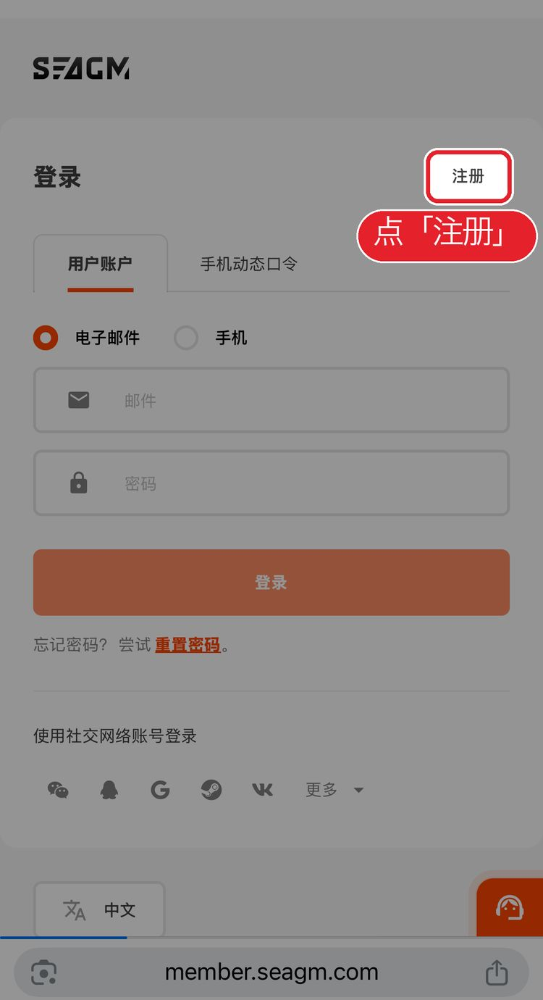

**② 填邮箱，点「发送验证码」，填邮件里的 6 位验证码，勾选同意条款，点「继续」。**

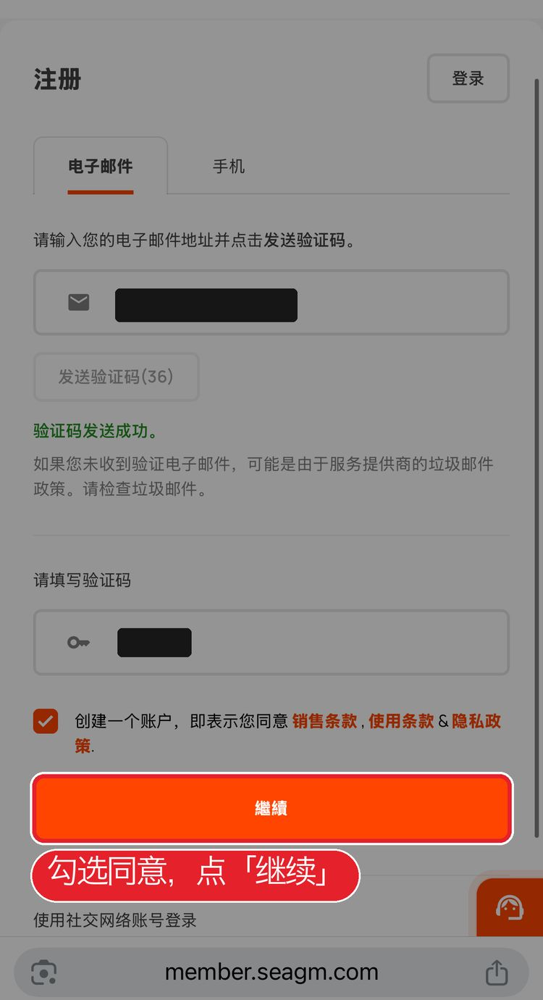

**③ 设密码（8–20 位，大小写字母加数字），点「完成注册」。以后看兑换码还要输这个密码。**

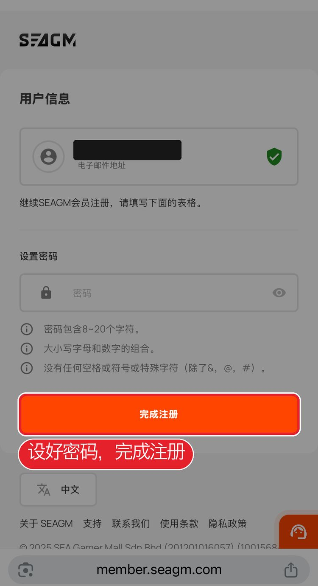

## 选卡下单（④–⑨）

**④ 在站内搜 Apple，选粉色的「Apple 礼品卡(美国)」，右上角确认是 CNY。** 用直达链接会直接到第 ⑤ 步。

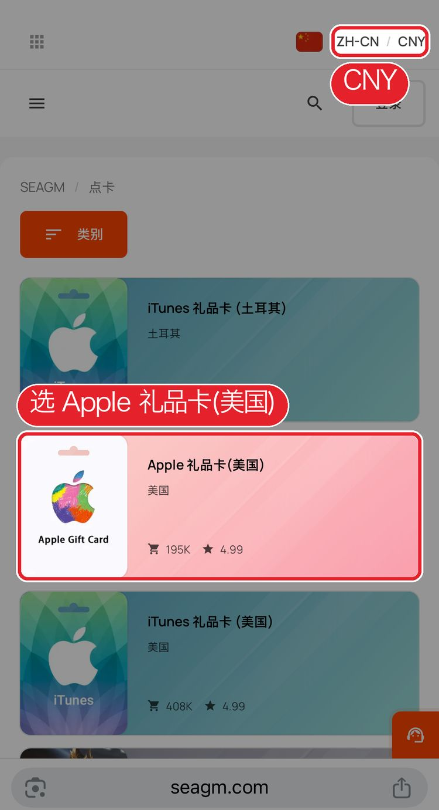

**⑤ 商品页默认是 2 美金，点这一栏换面额。**

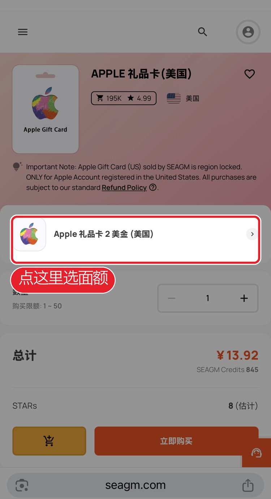

**⑥ 选「Apple 礼品卡 20 美金(美国)」，¥138.13，点「确认」。**

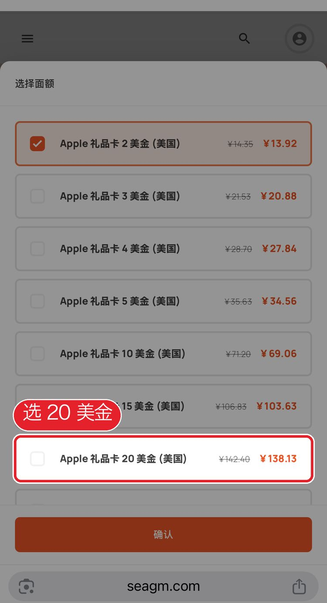

**⑦ 总计 ¥138.13，点「立即购买」。**

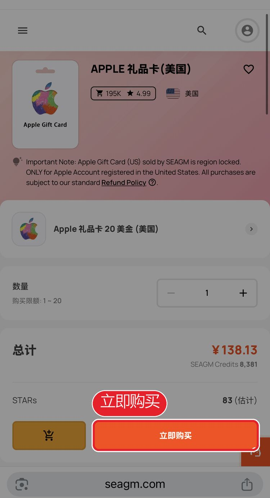

**⑧ 结账页：原价 ¥142.40，折扣 3%，应付 ¥138.13，点「立即支付」。**

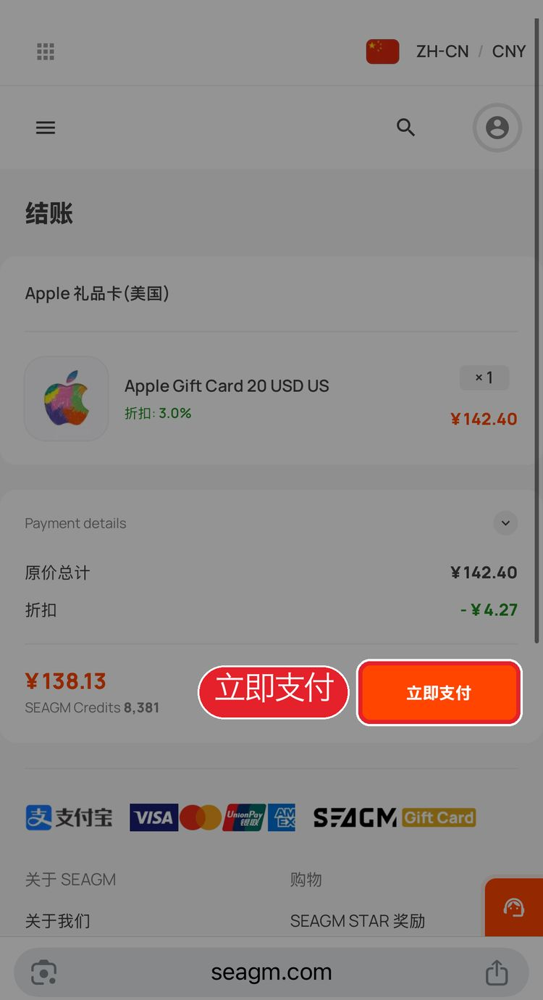

**⑨ 付款页确认是 Pay with 支付宝，点 PAY NOW。**

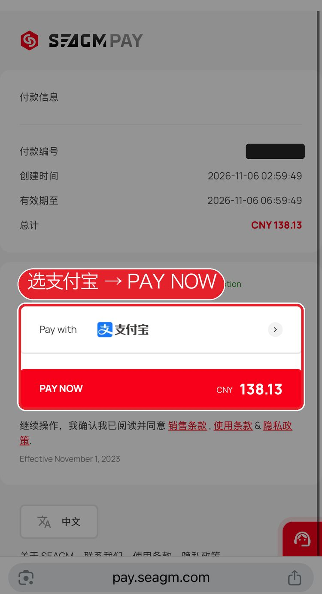

## 第一次付款：先绑手机（⑩–⑫）

**⑩ 第一次付款会弹出 Update user information，要先绑手机：点右边的箭头。**

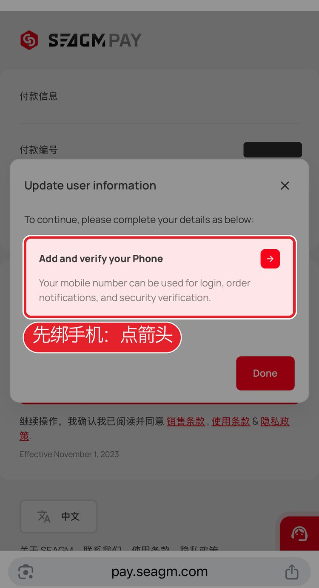

**⑪ 选 +86，填手机号，点 Send verification code，填短信验证码，点 Verify。**

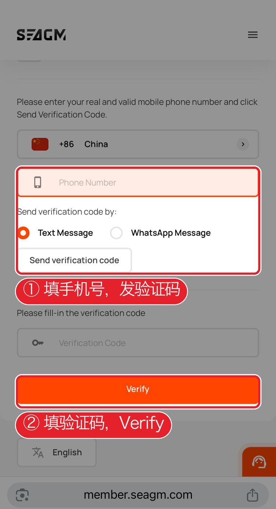

**⑫ 回到弹窗显示绿勾，点 Done，再点一次 PAY NOW。**

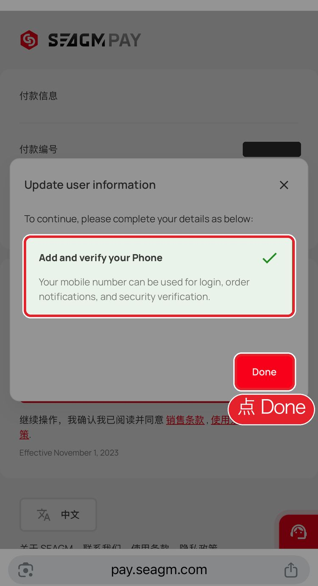

## 支付宝付款，拿兑换码，兑换（⑬–⑲）

**⑬ 跳到支付宝收银台：输入 6 位支付密码，点「确认付款」。** 要求先登录的，按页面提示登录支付宝。收银台可能默认选花呗，想用余额或银行卡点「其他付款方式」。

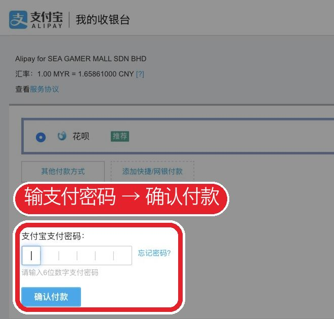

**⑭ 付款成功，页面自动跳回 SEAGM，显示交易成功，点 Retrieve Code/Key。**

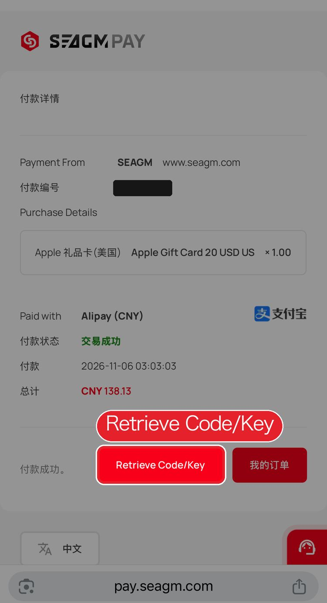

**⑮ 输入 SEAGM 的登录密码，点「提交」。**

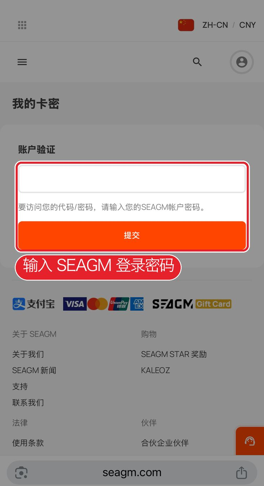

**⑯ 刚付完显示「待发货」，多刷新几次页面**，这次约 3 分钟后出现「显示卡片」，点它。邮箱也会收到 Orders Are Ready 通知。

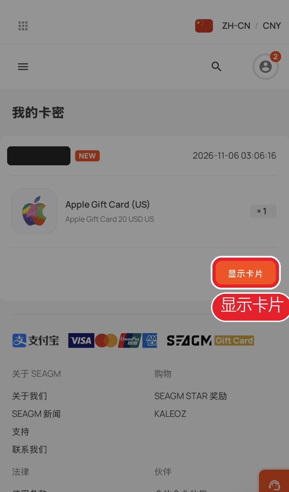

**⑰ 兑换码（SEAGM 页面上叫「卡密」）是 16 位字母和数字，复制下来。**

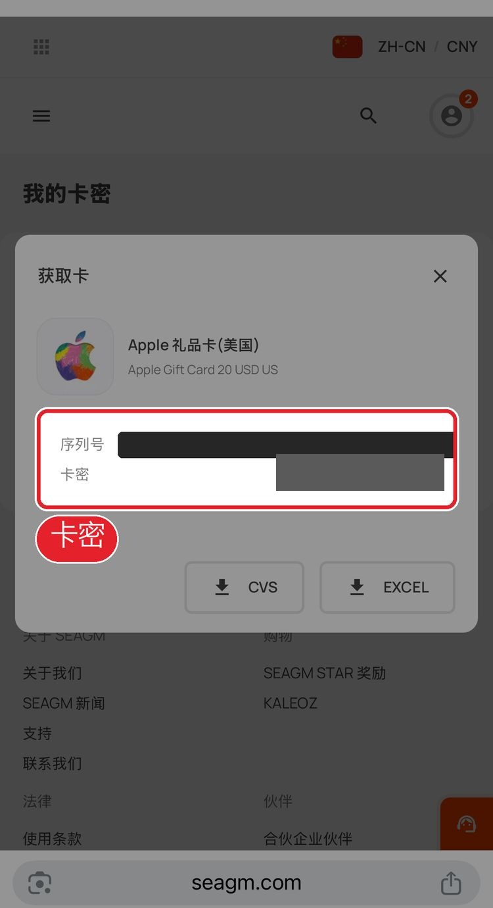

*图中兑换码已遮挡；该卡已被原作者兑换。*

**⑱ App Store → 右上角头像 → Redeem Gift Card or Code（中文界面是「兑换代码」），粘贴兑换码，点 Redeem。**

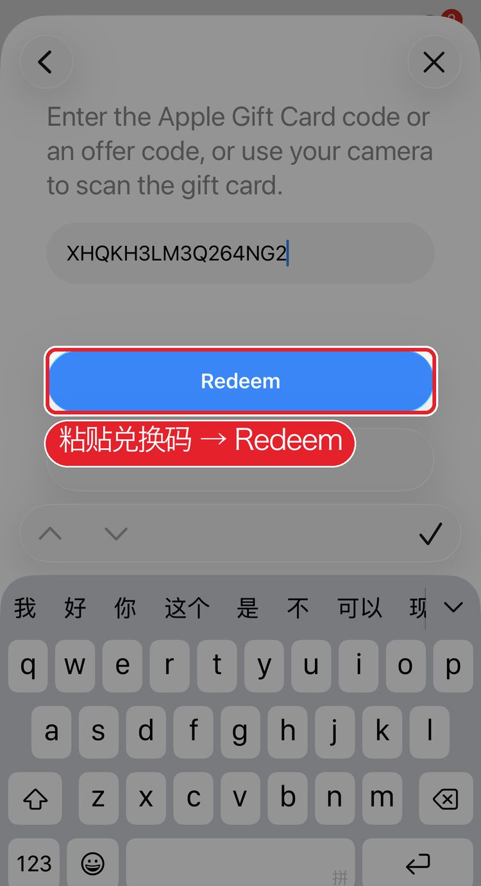

**⑲ 显示 $20.00 Added，余额 $20.00，兑换成功。**

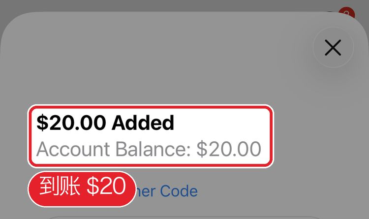

*以上 19 张截图来源：chatgpt-plus-china-guide（Avarce），2026-11-06 实测。邮箱、验证码、手机号、订单序列号等个人信息已由原作者遮挡，兑换码由本站补充遮挡。*

兑换以后和 Pockyt 买的卡一样：到 iOS 版 ChatGPT App 里升级 Plus，用余额付 $19.99，见 [ChatGPT iOS 订阅教程](../chatgpt/subscribe-ios.md)。这是原作者一次完整的实测，说明流程走得通、卡能兑换；价格和库存以 SEAGM 页面为准。

## Pockyt 与 SEAGM 对比

| | Pockyt Shop | SEAGM |
| --- | --- | --- |
| 在哪买 | 支付宝里直接打开 | 浏览器打开网站，付款时跳到支付宝 |
| 要准备什么 | 一个收码邮箱 | 注册账号（邮箱验证码 + 密码），第一次付款前绑手机号 |
| $20 卡实付 | ¥134.44（10-13 复测） | ¥138.13（11-06 实测） |
| 面额 | $10–200 固定面额，另有 $2~500 自选 | $2 到 $500 的固定面额，订 Plus 选 $20 |
| 兑换码在哪看 | 下单邮箱，或 Pockyt Shop 的「订单」 | SEAGM 的「我的卡密」，要再输一次登录密码；邮箱只收到到货通知 |
| 库存 | 11-05 缺货，11-06 中午补货 | 11-06 实测有货 |

*表中价格为原作者历史实测记录，当前可用性尚未重新验证。*

## 常见问题

**Q：开着代理打不开 SEAGM？**
A：网站拦了部分机房 IP（Error 1005 / Access denied）。关掉代理、用国内网络直接打开。

**Q：兑换码一旦展示能退吗？**
A：SEAGM 的数字礼品卡有地区限制。兑换码一旦展示、交付或使用，通常不能退款或换区；如果买错地区，**先不要查看兑换码**，立即联系平台客服。（来源 chatgpt-plus-subscription-guide 的提醒）

**Q：付了款一直「待发货」？**
A：原作者实测约 3 分钟到卡，多刷新几次页面。长时间不到货，带订单号联系 SEAGM 右下角在线客服。

## 相关教程

- [Pockyt 支付宝买卡（主推渠道）](./apple-gift-card-pockyt.md)
- [Apple 官网买礼品卡](./apple-gift-card-official.md)
- [礼品卡兑换与失败排查](./apple-gift-card-redemption.md)
- [ChatGPT iOS 订阅完整流程](../chatgpt/subscribe-ios.md)

---

## 来源与修改说明

- 来源仓库：[chatgpt-plus-china-guide](https://github.com/Avarce/chatgpt-plus-china-guide)（Avarce，无许可证，经项目负责人确认授权）；[chatgpt-plus-subscription-guide](https://github.com/daydayup-xq/chatgpt-plus-subscription-guide)（daydayup-xq，CC BY 4.0，SEAGM 通用购买步骤与退款提醒）。
- 原始文档：A README「Pockyt Shop 缺货怎么办：用 SEAGM 买美区礼品卡」全节；D README 方法二「通过世嘉（SEAGM）购买」段。
- 修改情况：保留原作者全部 19 步实测与日期、金额；将「我们实测」改为「原作者实测」；删除商家推广；内部链接改为本站相对链接。
- 图片来源：A 仓库 `images/seagm-step1~19-*.jpg` 共 19 张；step17 兑换码由本站遮挡，其余个人信息原作者已遮挡。
- 原教程记录日期：2026-11-06（A 实测）、2026-09-10（D）；本整合核对日期：2026-11-15。价格与库存为历史记录，当前可用性尚未重新验证。