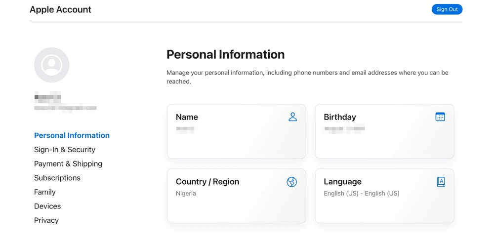
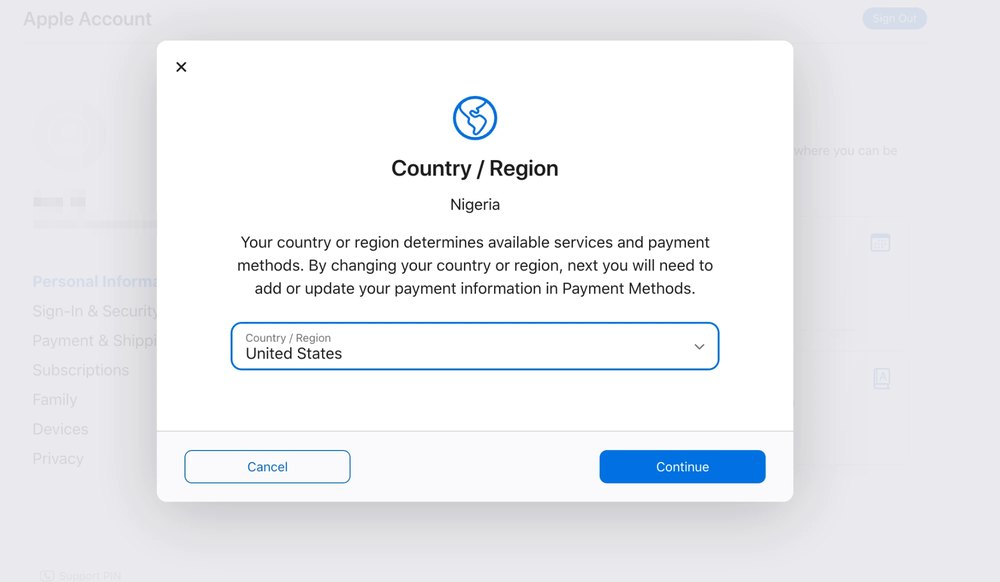
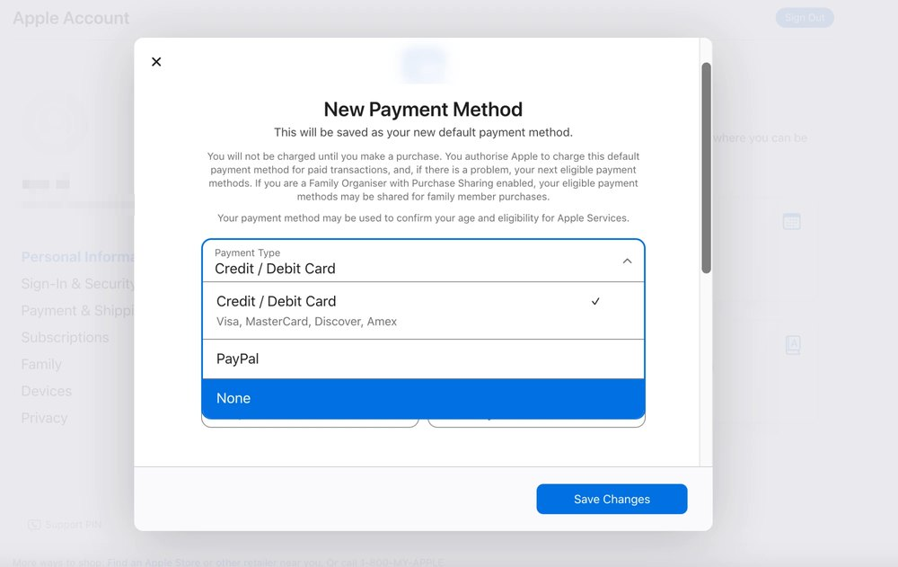

# Apple ID 怎么改成美区？付款方式选 None，账单地址填免税州

> 适用：已有 Apple ID，想把它改成美区用于 App Store 订阅的用户。更推荐的做法是[单独注册一个美区 Apple ID](./apple-id-registration.md)，主力账号不动。
> 核心步骤来自 2026-10-16 的实测记录；最后核对日期 2026-11-15。

## 先说结论

在 [account.apple.com](https://account.apple.com) 的「个人信息 → 国家/地区」里选 United States，然后在「New Payment Method」弹窗里**点开 Payment Type 下拉框，选最后一项 None**，账单地址填美国免税州（推荐 Oregon），全程不用绑卡。

**动手前先开美国节点**，用全局模式，尽量选干净的 IP。付款方式里能不能选 None，和 Apple 判断你当前在哪里有关（见[排查表](#看不到-none-怎么办)）。

## 改区前必须知道的事

- **国区账号改区 = iCloud 内容出境。** Apple 中文版说明写明：把地区从中国大陆改到其他国家或地区，等于同意云上贵州把你的 iCloud 内容转移到境外的 Apple 服务器，转移完成后删除境内服务器上的内容。不想动主力 iCloud，就用单独的美区 Apple ID。
- 改区前通常需要：用完原账户余额；取消会阻止换区的订阅并等它到期；退出可能影响换区的家人共享；处理待办交易（预购、影片租借、退款）。余额少于一件商品价格的，联系 Apple 支持清零。
- 不建议频繁切换主力 Apple 账户的地区。已经有长期使用的海外区账户时，维持原地区通常更省事。
- 切换不同区的 Apple ID 只改变支付方式，**对 ChatGPT 账号里的信息和记忆没有影响**（来源 FAQ）。但订阅归属受 Apple ID 绑定规则限制，见 [账号安全](./account-security.md)。

## 改区三步（附实测截图）

以下为原教程作者 2026 年 10 月 16 日在电脑浏览器的实测，全程不用绑卡。

### ① 个人信息 → 国家/地区

打开 [account.apple.com](https://account.apple.com)（旧地址 appleid.apple.com 会跳到这里），登录要改区的 Apple ID，在「个人信息（Personal Information）」里点「国家/地区（Country / Region）」。

### ② 选 United States，点 Continue

弹窗会提示改完地区后要更新付款方式，下一步就是。

### ③ Payment Type 下拉框选最后一项 None

弹出「New Payment Method」时，Payment Type 默认显示 Credit / Debit Card，下面跟着一排填卡的输入框，看起来像必须绑卡。**点开这个下拉框，None 在最后一项。** 选好后，姓名和账单地址照常填写，State 选 **Oregon（OR）**，City、ZIP 和电话也填 Oregon 的，和 State 对得上，再点 Save Changes。

*以上三张截图来源：chatgpt-plus-china-guide（Avarce），2026-10-16 实测。*

用 iPhone 改也可以，Apple 给的路径是：**设置 → 你的姓名 → 媒体与购买项目 → 国家/地区**。中文界面下 None 显示为「无」。

## 为什么账单州要选 Oregon（免税州）

[Oregon 州税务局](https://www.oregon.gov/dor/programs/businesses/Pages/sales-tax.aspx)明确说明该州不征一般销售税，因此 ChatGPT iOS 内购应按页面标价 $19.99 结算。设置完成后，付款前再确认结算页总额确实是 $19.99。

这一步不能省。Apple 在美国按账单地址收销售税，州、县、市、区都按账单地址认定（见 Apple 开发者文档的[交易税报告字段说明](https://developer.apple.com/help/app-store-connect/reference/transaction-tax-report-fields)）。$20 礼品卡付完 $19.99 只剩 $0.01，账单地址在收税的州，加上税就超过余额，付款时会提示「必须提供付款信息才能继续购买」，处理办法见 [iOS 订阅教程的排查段](../chatgpt/subscribe-ios.md#付款时提示必须提供付款信息才能继续购买)。

其他可选免税州：蒙大拿、阿拉斯加、特拉华、新罕布什尔（来源 FAQ）。

## 看不到 None 怎么办

按下表从上往下排查。第 2 到第 5 条依据 Apple 官方支持文章：[更改 Apple 账户国家或地区](https://support.apple.com/zh-cn/118283)、[从 Apple 账户中移除付款方式](https://support.apple.com/zh-cn/118291)。

| 先查什么 | 为什么没有 None | 怎么处理 |
| --- | --- | --- |
| 1. 有没有点开 Payment Type | None 收在下拉框里，默认显示的是 Credit / Debit Card | 点开下拉框，看最后一项 |
| 2. 当前是不是在美国 | Apple 的说明是：改区时可能要为新地区填付款方式，不想填的话，要等本人到了那个国家或地区再操作。Apple 没写怎么判断位置，原作者的经验是开着美国节点时能看到 None | 开美国节点的全局模式，退出 account.apple.com 重新登录，再改一次 |
| 3. 账号有没有欠款 | 有未付款项时，Apple 可能不让移除付款方式，只能更换 | 改区前先在原地区把欠款付清（例如国区账号绑支付宝或微信付掉），再改 |
| 4. 有没有生效中的订阅 | 有 iCloud+ 等订阅时，账号必须至少保留一种付款方式 | 设置 → 你的姓名 → 订阅，全部取消，等当前订阅期结束再改 |
| 5. 有没有加入家人共享 | 家庭组织者开着「购买项目共享」时必须保留付款方式；家庭成员可能根本改不了地区 | 组织者先关掉「购买项目共享」；成员先退出家庭组 |
| 6. 选了 None，保存不了 | 账单信息没填全 | 姓名、街道、城市、State、5 位邮编、电话逐项填好，State 选 Oregon（OR），城市和邮编也用 Oregon 的 |

**都排除了还是没有 None？** 换一个新注册的 Apple ID，专门用于美区 App Store。Apple 对不想填付款方式的人，给的办法也是到当地后新建账户；Apple 的[创建账户说明](https://support.apple.com/zh-cn/108647)里，填付款方式这一步同样可以选「无」。注册和第一次登录 App Store 时都开着美国节点。

**点 Continue 后提示无法更改地区？** 这一步和 None 无关。按 Apple 的说明，先用完账户余额，取消订阅并等订阅期结束，等会员资格、预购、影片租借和退款都处理完；余额少于一件商品价格的，联系 Apple 支持清零。

## 常见问题

**Q：可以把美区 Apple ID 再改成土耳其区吗？**
A：可以但不建议。苹果对跨区支付检查很严格，有可能会强制要求添加本地信用卡支付方式。（来源 FAQ，记录于 2025-06-20，当前可用性尚未重新验证。）

**Q：换 Apple ID 后，订阅到的还是原来的 ChatGPT 账户吗？**
A：只要 iOS 设备上登录的还是原来的 ChatGPT 账户，订阅就进到原账户；不过要先取消原来的 Plus 订阅，等到期以后再用新的 Apple ID 订阅。注意 Apple ID 与 ChatGPT 账号的首次内购绑定规则，见 [账号安全](./account-security.md)。

**Q：社区教程里的地址生成器靠谱吗？**
A：地址生成器只能帮助补齐格式，不能保证付款验证通过。使用银行卡时，账单资料仍应以发卡方登记的信息为准。（来源 chatgpt-plus-subscription-guide 的提醒）

## 相关教程

- [注册美区 Apple ID（推荐路线）](./apple-id-registration.md)
- [ChatGPT iOS 订阅完整流程](../chatgpt/subscribe-ios.md)
- [支付宝买美区礼品卡（Pockyt）](./apple-gift-card-pockyt.md)

---

## 来源与修改说明

- 来源仓库：[chatgpt-plus-china-guide](https://github.com/Avarce/chatgpt-plus-china-guide)（Avarce，无许可证，经项目负责人确认授权）；[chatgpt-plus-subscription-guide](https://github.com/daydayup-xq/chatgpt-plus-subscription-guide)（daydayup-xq，CC BY 4.0）；[Way-to-ChatGPT-Plus](https://github.com/farion1231/Way-to-ChatGPT-Plus)（farion1231，Apache-2.0，FAQ）。
- 原始文档：A README「Apple ID 改成美区：付款方式选 None」「免税州设置」「看不到 None 怎么办」段；D README「Apple 账户需要换区怎么办」段；W `FAQ.md`。
- 修改情况：合并改区前置条件；内部锚点改为本站相对链接；保留原作者实测日期与经验表述；未改动操作步骤。
- 图片来源：A 仓库 `images/apple-id-none-step1-region.jpg` 等 3 张（2026-10-16 实测截图）。
- 原教程记录日期：2026-10-16 / 2026-11-12（A）、2026-09-10（D）、2025-06-20（W）；本整合核对日期：2026-11-15。