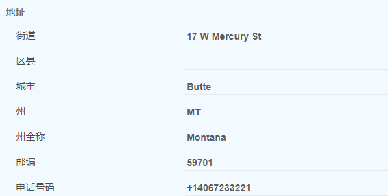
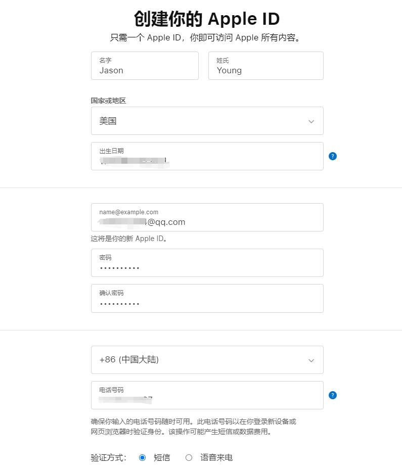
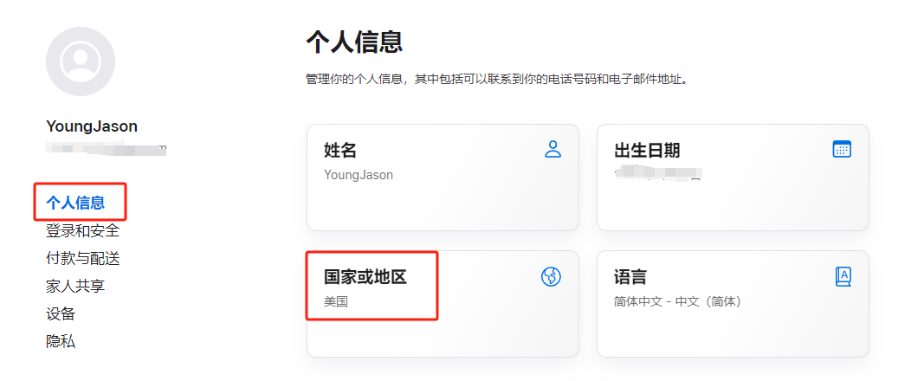
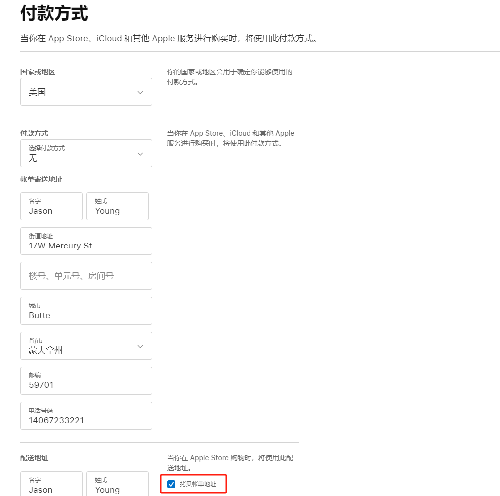
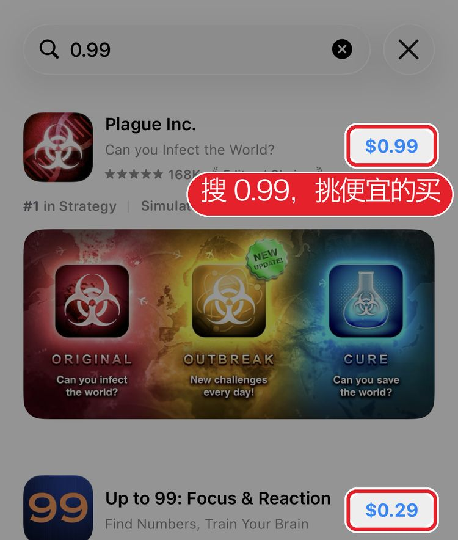

# 怎么注册美区 Apple ID？不需要美国信用卡和手机号

> 适用：想用美区 App Store 订阅 ChatGPT Plus、Claude Pro 等应用，但没有美国银行卡的用户。
> 本文整合自多个公开教程，最后核对日期 2026-11-15。注册界面可能随 Apple 更新变化，以页面实际提示为准。

## 先说结论

注册美区 Apple ID **不需要美国信用卡，也不需要美国手机号**：国家或地区选美国，邮箱和手机号都可以用中国大陆的，付款方式选「无」（None），账单地址填一个美国免税州地址即可。注册完成后，这个 Apple ID 就能在 App Store 用礼品卡余额正常购买和订阅。

> 来源教程记录于 2025-06-20（Way-to-ChatGPT-Plus）与 2026-09-10（chatgpt-plus-subscription-guide），当前可用性尚未重新验证。Apple 的注册政策可能调整，若页面要求变化，以 [Apple 官方创建账户说明](https://support.apple.com/zh-cn/108647) 为准。

## 为什么推荐单独注册，而不是改现有账号

- 主力 iCloud 账号不必跟着改区，照片、备忘录、家人共享都不受影响。
- 不用来回切换地区；国区账号留着分开使用。
- 把现有国区 Apple ID 改成美区，等于同意云上贵州把 iCloud 内容转移到境外服务器（详见 [Apple ID 改区教程](./apple-id-region-change.md)）。

**Apple ID 和 ChatGPT / Claude 账号一定要自己注册，千万不要购买批量注册的成品账号，否则付费后封号的风险非常高。**（原教程作者反复强调的经验判断）

## 准备什么

1. 一个能长期接收邮件的邮箱（大陆邮箱即可）。
2. 一个能长期接收验证码的手机号（大陆 +86 手机号即可）。
3. 一个美国免税州地址（见下一节）。
4. 建议全程使用美国节点的网络环境注册和首次登录 App Store。

## 第一步：准备美国地址（免税州）

注册美区 Apple ID 和购买 Apple 礼品卡都需要一个美国地址。可以用地址生成器获取，例如 [美国地址生成器（蒙大拿州）](https://www.meiguodizhi.com/usa-address/montana)。

*图片来源：Way-to-ChatGPT-Plus（farion1231），地址生成器页面截图。*

注意两点：

- **选免税州。** 美国的州分为免税州和非免税州。如果 ChatGPT Plus 订阅扣费超过 $20，大概率是填了非免税州地址被加了消费税。原教程推荐蒙大拿州（Montana）；另一来源实测使用俄勒冈州（Oregon），同样免税。常见免税州：蒙大拿、俄勒冈、阿拉斯加、特拉华、新罕布什尔。
- **保存好这一组地址和电话。** 每次购买礼品卡、填写账单信息都会用到。地址生成器只用于补齐账单地址格式；它不能保证通过任何付款验证，使用银行卡时账单资料仍应以发卡方登记信息为准。

## 第二步：在 Apple 官网注册

1. 打开 [Apple 账户注册页面](https://appleid.apple.com/account)（会跳转到 account.apple.com），建议全程使用美国节点。
2. 填写邮箱、密码、姓名、出生日期，**国家或地区选美国**。邮箱和手机号都可以使用大陆的。

3. 填完邮箱和手机的验证码后，进入账户管理界面。

4. 新注册的 ID 想在 App Store 支付，需要先填写付款方式和账单地址：点击「个人信息」→「国家或地区」。

5. 国家选美国，**付款方式选「无」（None）**——只通过礼品卡充值，不需要绑定支付方式。然后填入第一步准备的美国地址和联系方式，保存。

如果提示电话号码无效，去地址生成器多刷新几个试试：这个号码只是账单地址的一部分，不需要真实有效。保存信息后，这个 Apple ID 就可以在 App Store 正常购买。

> 看不到「无 / None」选项怎么办？见 [Apple ID 改区教程中的排查表](./apple-id-region-change.md#看不到-none-怎么办)，注册场景同样适用。

### 另一来源的注册路径（account.apple.com）

chatgpt-plus-subscription-guide 给出的步骤基本一致，补充了几点：

1. 进入 [Apple 账户页面](https://account.apple.com)，选择「创建 Apple 账户」。
2. 填写常用邮箱、密码、姓名和出生日期，选择准备长期使用的国家或地区。
3. 填写自己能长期接收验证码的手机号，完成邮箱和手机验证。
4. 在 iPhone 中进入「设置 → Apple 账户 → 媒体与购买项目」，退出当前购买账户，选择「不是你本人？」并登录新账户。
5. 返回 App Store，确认头像页显示的是新账户。

**只需要切换「媒体与购买项目」，不必退出整台手机的 iCloud 和 iMessage。** 以后查看账单、余额或取消 ChatGPT 订阅，都要使用这个新账户，所以一定要保管好邮箱、密码和恢复手机号。

## 第三步（建议）：新账号先买一两个便宜 App

这是 A01 来源作者的经验，不是 Apple 写明的规则：刚建好的账号，第一笔就用余额付 $19.99，比较容易卡住，弹出「购买未完成，提交申请至 Apple 支持以供审核」。可以先在 App Store 搜「0.99」，挑一两个便宜的 App 买下来，下载打开用一用，让账号有一些正常的购买和使用记录，再去订 Plus。这样做不保证一定不被审核，只是让账号看起来更像正常在用。

*图片来源：chatgpt-plus-china-guide（Avarce），2026-11-06 截图。*

## 常见问题

**Q：注册美区 Apple 账号需要美国信用卡和手机号吗？**
A：不需要。全程不需要美国信用卡，使用国内手机号即可注册（来源 GetClaudeProByAppleIO 的 FAQ；Way-to-ChatGPT-Plus 同样确认大陆邮箱和手机可用）。原教程记录于 2026-10-06 与 2025-06-20，当前可用性尚未重新验证。

**Q：注册完就能直接订 ChatGPT Plus 吗？**
A：还需要充值礼品卡余额。完整路线见 [ChatGPT iOS 订阅教程](../chatgpt/subscribe-ios.md)；礼品卡购买见 [Pockyt](./apple-gift-card-pockyt.md)、[SEAGM](./apple-gift-card-seagm.md)、[Apple 官网](./apple-gift-card-official.md)。

**Q：一个 Apple ID 能给多个 ChatGPT 账号订阅吗？**
A：不能。首次 Apple 内购后，Apple ID 与该 ChatGPT 账号永久绑定，详见 [账号安全与付款前检查](./account-security.md)。

## 相关教程

- [Apple ID 改区：付款方式选 None](./apple-id-region-change.md)
- [支付宝买美区礼品卡（Pockyt）](./apple-gift-card-pockyt.md)
- [Apple 礼品卡兑换与失败排查](./apple-gift-card-redemption.md)
- [ChatGPT iOS 订阅完整流程](../chatgpt/subscribe-ios.md)

---

## 来源与修改说明

- 来源仓库：[Way-to-ChatGPT-Plus](https://github.com/farion1231/Way-to-ChatGPT-Plus)（farion1231，Apache-2.0）；[chatgpt-plus-subscription-guide](https://github.com/daydayup-xq/chatgpt-plus-subscription-guide)（daydayup-xq／晓庆在学习，CC BY 4.0）；[chatgpt-plus-china-guide](https://github.com/Avarce/chatgpt-plus-china-guide)（Avarce，无许可证，经项目负责人确认授权）；[GetClaudeProByAppleIO](https://github.com/sunreview/GetClaudeProByAppleIO)（sunreview，无许可证，经项目负责人确认授权，仅取 FAQ）。
- 原始文档：`注册美区Apple ID.md`、`获取美国联系方式及地址.md`、`使用美国区Apple ID订阅.md`（W）；README 方法二（D）；README 路线 C「新注册账号」段（A）；README FAQ 5（S）。
- 修改情况：合并重复注册步骤；将「科学上网」表述统一为「美国节点网络环境」；补充导航、适用说明与日期标注；未改动原作者的操作步骤与经验判断；删除原仓库中的商家推广内容。
- 图片来源：W 仓库 `imgs/id1-3.png`、`imgs/Montana.png`；A 仓库 `images/apple-new-account-cheap-apps-20261106.jpg`。均已确认无个人敏感信息。
- 原教程记录日期：2025-06-20（W）、2026-09-10（D）、2026-11-12（A）；本整合核对日期：2026-11-15。