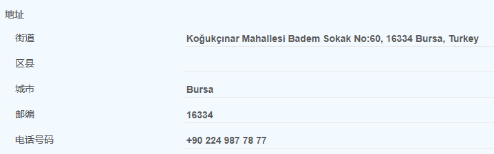
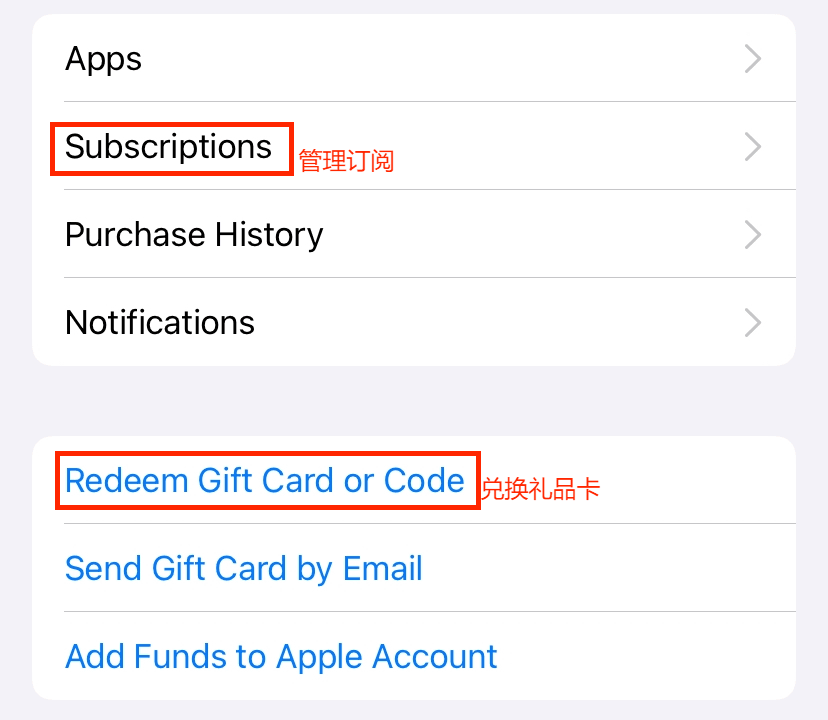

# 土耳其区 Apple ID 低价订阅 ChatGPT 还可行吗？（历史记录，待核查）

> **本篇为历史记录，价格与渠道信息均已过期，当前可用性尚未重新验证。** 低价区订阅属于擦边行为，存在封号风险，对安全在意的用户请使用美元区订阅。
> 原教程记录于 2025-06-20（Way-to-ChatGPT-Plus）；最后核对日期 2026-11-15。

## 原文记录了什么

来源 W 的作者记录：由于土耳其里拉持续走低，土耳其区一度成为各种订阅的低价区，当时通过土耳其区 App Store 订阅 ChatGPT Plus 和 X Premium 约为美元订阅的 **6.5 折**左右。

**这些价格都是 2025 年中的记录。** 原 FAQ 还记录：土耳其区 ChatGPT Pro 为 8000 里拉（当时折合 208 美元，比美元直接订阅更贵）；Claude Pro 为 800 里拉（当时折合 20.17 美元，也比美元更贵）。原文另提到尼日利亚区曾有 $6 的 ChatGPT Plus 低价。**以上价格全部未经当前核实，不要据此操作。** Apple 与 OpenAI 会调整地区定价，低价区随时可能消失。

## 原文的操作思路（概要）

1. 用[土耳其地址生成器](https://www.meiguodizhi.com/tr-address)获取土耳其地址。

2. 参照 [美区 Apple ID 注册教程](./apple-id-registration.md)，把美国部分全部替换成土耳其。
3. 购买土耳其区礼品卡后，在 App Store 登录土耳其区账号（不要在系统设置里登录整个 iCloud），头像 → Redeem Gift Card or Code 兑换充值。
4. 打开 ChatGPT App 订阅 Plus，取消订阅在 App Store 的「订阅」里操作。

原文记录的购卡渠道问题：之前可以从 oyunfor 购买土耳其礼品卡，但当时支付渠道出了问题（中国地区接受验证短信的号码被固定为 05** 的固定电话格式，导致无法正常输入手机号），作者建议通过 WhatsApp 联系 oyunfor 客服解决，或从闲鱼购买。

*两张截图来源：Way-to-ChatGPT-Plus（farion1231），2025-06-20 前的记录。渠道现状未核实。*

## 风险与原文 FAQ（保留原作者判断）

- **封号风险：** 原作者判断，ChatGPT 绝大部分封号都是因为 IP 问题或者虚拟卡支付，但低价区订阅归根结底还是擦边行为（尤其从美国切换到土耳其），对安全很在意的朋友请使用美元订阅。
- **跨区改区：** 可以把现有 Apple ID 地址从美国改成土耳其，但不建议——苹果对跨区支付检查很严格，有可能会强制要求添加本地信用卡支付方式。
- **账号安全：** Apple ID 和 ChatGPT 账号一定要自己注册，不要购买批量注册的账号。
- **节点要求：** 原文建议全程使用土耳其节点；ChatGPT 对节点质量要求高，不然容易出现降智封号等问题。
- **Claude 提醒：** 风控严格的产品（原作者点名 Claude），新注册账号请先使用一段时间再考虑订阅 Pro。

## 当前建议

1. 想确认土耳其区现价，需要自行登录土区 App Store 查看实时标价，并换算汇率后再与美元区比较——本篇不提供未经核实的现价。
2. 从闲鱼等渠道购买低价卡密的风险见 [礼品卡渠道选择](./apple-gift-card-pockyt.md#买卡渠道怎么选)：Apple 怀疑礼品卡来路不正时，可以作废卡、不退款，甚至停用账户。
3. 更稳妥的路线：[美区礼品卡 + iOS 订阅](../chatgpt/subscribe-ios.md)（$19.99，免税州无额外税）。

## 相关教程

- [注册美区 Apple ID](./apple-id-registration.md)
- [Apple ID 改区](./apple-id-region-change.md)
- [支付路线历史档案](./payment-history-archive.md)

---

## 来源与修改说明

- 来源仓库：[Way-to-ChatGPT-Plus](https://github.com/farion1231/Way-to-ChatGPT-Plus)（farion1231，Apache-2.0）。
- 原始文档：`注册土耳其区Apple ID.md`、`使用土耳其Apple ID低价订阅.md`、`FAQ.md` 相关条目。
- 修改情况：降级为历史记录并加「待核查」标注；保留原作者风险提示与经验判断；删除闲鱼导流倾向表述中的购买引导，仅保留风险说明；价格全部标注为过期记录。
- 图片来源：W 仓库 `imgs/Turkey.png`、`imgs/TurkeyCard1.png`。
- 原教程记录日期：2025-06-20；本整合核对日期：2026-11-15。当前可用性尚未重新验证。