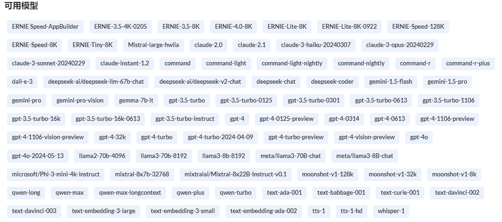
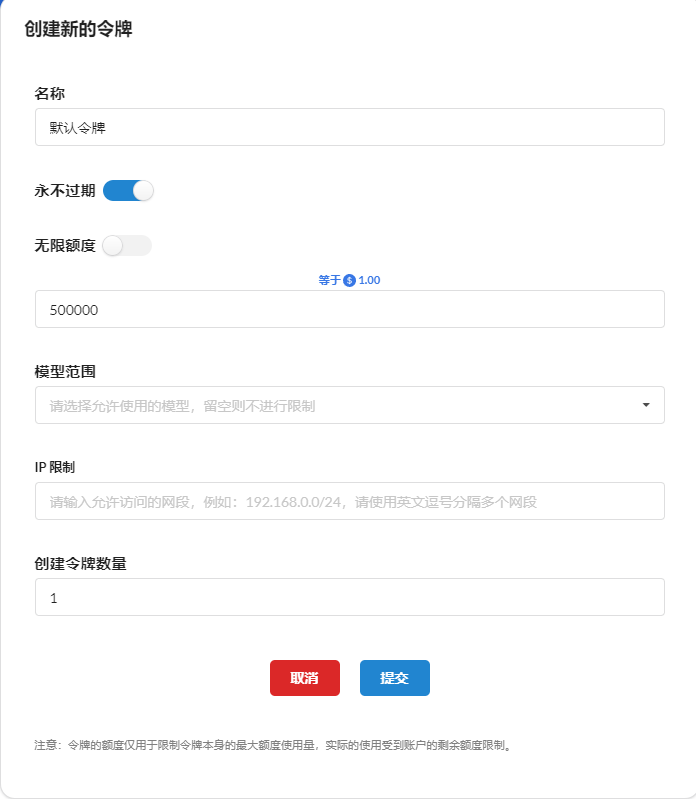
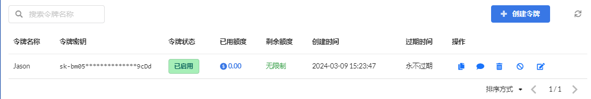
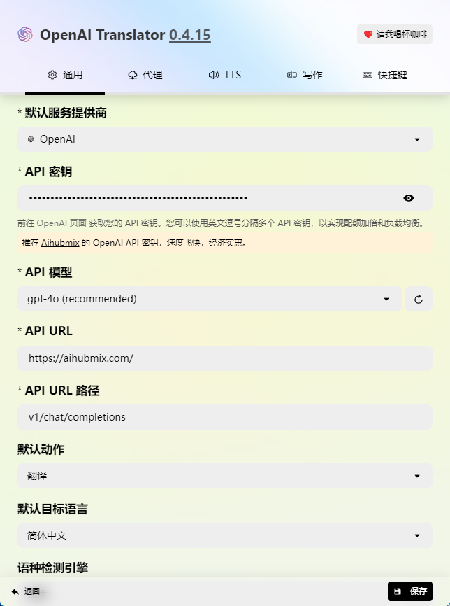
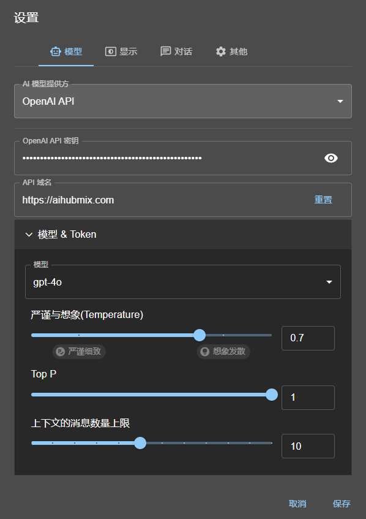
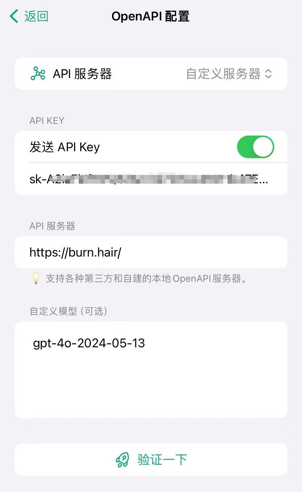

# 不用会员也能调模型？ChatGPT API 中转与客户端配置

> 适用：想在自己的软件、翻译工具或手机 App 里调用 GPT 等模型，而不是只用网页版聊天的读者。
> 最后核对日期：2026-11-15。原教程记录于 2025-06，中转站可用性与模型名单尚未重新验证。

## 先说结论

- **ChatGPT 会员（Plus / Pro）与 OpenAI API 分开计费**：买会员不等于给 API 账户充值，API 调用按量付费。套餐区别见 [ChatGPT 套餐选择](../chatgpt/plus-vs-pro.md)。
- API 可以理解为**电力**，客户端是各种电器；网页版 ChatGPT 本身就是官方客户端，背后也在用 API。
- 使用官方 API 同样要面对网络、支付渠道、封号等问题，所以原作者介绍的是**国内 API 中转站**的用法：拿到「中转接口地址 + API-Key」两个数据，填进客户端即可。
- 中转站是第三方服务，不是 OpenAI 官方渠道，使用前先读文末的风险提示。

## 网页版与 API 的优缺点对比

| 特性 | 网页版 ChatGPT | API |
| --- | --- | --- |
| 优点 | 简单易用，无需编程知识；界面友好；快速启动，无需设置；自动更新获取最新功能 | 高度灵活，可集成到各种应用；可扩展，支持高并发和复杂任务；按量计价，轻度使用非常便宜 |
| 缺点 | 有额度限制，高强度使用需等待恢复；扩展性差，无法集成到其他应用；服务宕机或高负载时影响使用 | 需要一定编程知识和经验；需要初始设置（API 配置和认证）；需要借助第三方客户端使用 |

> 原表还列有「API 不需要科学上网、不用担心封号」一条。这是原作者在**使用国内中转站**场景下的对比（记录于 2025-06）：中转站国内可直连、账号风险由平台承担。直连 OpenAI 官方 API 仍需相应的网络与支付条件，且官方账号同样有风控。此条为原作者经验判断，不是官方保证。

## 中转站怎么注册和使用

原作者列举了三个国内中转站作为示例（使用方式基本相同，可按喜好选择其他中转站；本文不构成推荐，可用性未重新验证）：

- [兔子 API](https://api.tu-zi.com/)
- [AiHubMix](https://aihubmix.com/)
- [头顶冒火](https://burn.hair/)

以 AiHubMix 为例，不仅支持 ChatGPT 系列模型，市面上的主流模型都支持：

要使用 API，需要两个关键数据：

1. **中转接口地址**：中转站的教程页面会注明，一般网站地址就是。以 AiHubMix 为例，接口地址是 `https://aihubmix.com`，另有高防御接口地址 `https://api.aihubmix.com`。
2. **API-Key（令牌）**：需要自己创建。在「令牌」页面点击「创建令牌」：

防止被盗用，可以加上**过期时间和额度**：

创建完成后，就有了中转接口地址和 API-Key。**API-Key 等同于付款凭据：不要发布到公开仓库、群聊或截图里，泄露后他人可以消耗你的余额。**

## 三个客户端的配置方法

### 1. OpenAI Translator（开源翻译软件）

[GitHub 地址](https://github.com/openai-translator/openai-translator)

- 默认服务提供商选择 **OpenAI**（大部分 API 中转站采用 OpenAI 的格式）。
- API 密钥填刚才创建的 API-Key（令牌）。
- 模型按中转站当前支持的列表选择。原文推荐 `gpt-4o`，这是 2025-06 记录时的模型名，现在请按平台实际可选模型填写。
- API URL 填中转站地址；URL 路径仿照 OpenAI 格式填 `v1/chat/completions`（不是每个客户端都需要填这一项）。

### 2. Chatbox（桌面客户端）

[Chatbox 官网](https://chatboxai.app/)

同样的办法填入密钥和 API 域名；模型下面的高级内容不了解的建议不要更改。

### 3. ChatX（手机 App）

[ChatX 推特地址](https://x.com/appchatx)

1. 设置 → AI 服务器设置，改为「API 模式」。
2. 进入「API 服务器配置」，勾选「发送 API Key」。
3. 填入中转接口地址和 API-Key。

## 风险提示

- **第三方中转不是官方渠道**：请求数据经过中转站服务器，不要通过中转传输敏感数据；平台稳定性、价格、存续时间都由第三方决定。
- 中转站的模型名单、价格、接口地址随时可能调整，配置前以其教程页当前说明为准。
- 只收 USDT、无备案信息、价格显著异常的平台格外小心；先小额充值测试。
- 本文三个示例站点来自 2025-06 的原教程，当前可用性尚未重新验证；链接仅为原文出处，不构成推荐或担保。

## 相关教程

- [ChatGPT Free / Go / Plus / Pro 怎么选](../chatgpt/plus-vs-pro.md)（会员与 API 计费的区别）
- [Codex 周额度与中转性价比](../codex/usage-and-limits.md)（Codex 场景的中转成本分析）
- [账号安全与付款前检查](../guides/account-security.md)

---

## 来源与修改说明

- 来源仓库：[Way-to-ChatGPT-Plus](https://github.com/farion1231/Way-to-ChatGPT-Plus)（farion1231，Apache-2.0）。
- 原始文档：`使用ChatGPT-API.md`（仓库最后提交 2025-06-20）。
- 修改情况：保留网页版 / API 对比表、电力比喻、两个关键数据、AiHubMix 令牌创建与三个客户端配置步骤；对「不需要科学上网、不用担心封号」补充适用场景说明并标注为原作者经验判断；`gpt-4o` 模型名标注时效；补充 API-Key 凭据安全与第三方中转风险提示；原文无推广链接，无需删除。
- 图片来源：W 仓库 `imgs/` 6 张配置截图（models / token / token2 / Translator / Chatbox / ChatX），已核对不含有效 API-Key 等敏感凭据。
- 原教程记录日期：2025-06-20（最后提交）；本整合核对日期：2026-11-15。原教程记录于 2025-06-20，当前可用性尚未重新验证。